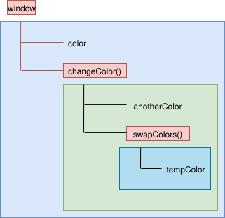

# 作用域模型

## 1 作用域模型分类

编程语言中，根据工作模型可将作用域分为两种：

- **词法作用域**：在代码写好的那一刻，变量的作用域已经确定（变量声明的位置决定，任何声明在某个作用域内的变量，都将附属于这个作用域），是静态的，是被大多数语言采用的模型。
- **动态作用域**：动态作用域是在运行时确定的。词法作用域关注函数在何处声明，而动态作用域关注函数从何处调用。一些 Bash、Perl 等语言采用的模型。

## 2 词法作用域

### 2.1 词法作用域概念

> 词法化：编译器在编译代码前首先会执行词法化（单词化），即对源码中的字符进行检查，如果是有状态的解析过程，还会赋予单词语义。比如： var a = 3 这段代码会被分解为 var、a、=、3 四个部分，在分解时需要判断 a 是一个独立的词法单元还是其他词法单元的一部分。

在词法作用域中，执行函数时会直接进入函数内部查找变量，找不到则去全局查找：

```js
var outerNum = 1

function outer() {
  console.log('outerNum = ', outerNum) // 1

  var innerNum = 10
  console.log('innerNum1 = ', innerNum) // 10

  function inner() {
    console.log(outerNum) // 1
    console.log('innerNum2 = ', innerNum) // 10
  }
  inner()
}

outer()
```

执行 outer 函数的时候，需要输出 outerNum 变量而 show 函数内部没有，则向外查找，输出外部全局的 outerNum 的值，依次类推。可以发现词法作用域是逐级包含的。

注意：**词法作用域常见的实现单元包括：函数作用域、块作用域**。

### 2.2 作用域链

这种逐级包含的作用关系，是在上下文代码执行的时候创建的，称为**作用域链**（scope chain），它决定了各级上下文中的代码在访问变量、函数时的顺序。上下文之间的连接是线性的、有序的。每个上下文都可以到上一级上下文中去搜索变量和函数，但任何上下文都不能到下一级上下文中去搜索。示例：

```js
var color = 'blue'

function changeColor() {
  var anotherColor = 'red'

  function swapColors() {
    // 这里可以访问 color、anotherColor、tempColor
    var tempColor = anotherColor
    anotherColor = color
    color = tempColor
  }

  // 这里可以访问 color、anotherColor
  swapColors()
}

// 这里只能访问 color
changeColor()
```

如图所示：



无论函数在哪里被调用，也无论它如何被调用，它的词法作用域都只由函数被声明时所处的位置决定。

### 2.3 遮蔽效应

作用域查找会在找到第一个匹配的标识符时停止。在多层的嵌套作用域中可以定义同名的标识符，这叫作“遮蔽效应”（内部的标识符“遮蔽”了外部的标识符）。抛开遮蔽效应，作用域查找始终从运行时所处的最内部作用域开始，逐级向外或者说向上进行，直到遇见第一个匹配的标识符为止。

### 2.4 欺骗词法

#### 2.4.1 eval()函数

全局上下文、函数上下文等都是在函数所声明的位置定义作用域，但是也有一些特殊情况可以在运行时修改词法作用域，不如 eval、with

```js
function foo(a, str) {
  eval(str) // 欺骗！
  console.log(a, b)
}
var b = 2
foo(1, 'var b = 3;') // 1 3
```

在执行 eval(..) 之后的代码时，引擎并不“知道”或“在意”前面的代码是以动态形式插入进来，并对词法作用域的环境进行修改的。引擎只会如往常地进行词法作用域查找。

注意：在严格模式的程序中，eval(..) 在运行时有其自己的词法作用域，意味着其中的声明无法修改所在的作用域。

```js
function foo(str) {
  'use strict'
  eval(str)
  console.log(a) // ReferenceError: a is not defined
}
foo('var a = 2')
```

#### 2.4.2 with 语句

with 通常被当作重复引用同一个对象中的多个属性的快捷方式，可以不需要重复引用对象本身：

```js
var obj = {
  a: 1,
  b: 2,
  c: 3,
}

// 单调乏味的重复 "obj"
obj.a = 2
obj.b = 3
obj.c = 4

// 简单的快捷方式
with (obj) {
  a = 3
  b = 4
  c = 5
}
```

with 的副作用：

```js
function foo(obj) {
  with (obj) {
    a = 2
  }
}

// o1 只有 a 属性
var o1 = {
  a: 3,
}
// o2 只有 b 属性
var o2 = {
  b: 3,
}

foo(o1)
console.log(o1.a) // 2

foo(o2)
console.log(o2.a) // undefined

// a 泄露到了全局
console.log(a) // 2
```

上述示例中，在 with 块内部，我们写的代码看起来只是对变量 a 进行简单的词法引用，实际上就是一个 LHS 引用。

传入对象 o2 时，o2 上没有属性 a，导致出现了全局变量 a。这是因为 with with 声明实际上是根据你传递给它的对象凭空创建了一个全新的词法作用域。当我们传递 o1 给 with 时，with 所声明的作用域是 o1，而这个作用域中含有一个同 o1.a 属性相符的标识符。但当我们将 o2 作为作用域时，其中并没有 a 标识符，因此进行了正常的 LHS 标识符查找。o2 的作用域、foo(..) 的作用域和全局作用域中都没有找到标识符 a，因此当 a ＝ 2 执行时，自动创建了一个全局变量（因为是非严格模式）。这是一个非常恶心的设定！！！

可以将一个没有或有多个属性的对象处理为一个完全隔离的词法作用域，因此这个对
象的属性也会被处理为定义在这个作用域中的词法标识符。

#### 2.4.3 总结

eval(..) 和 with 会在运行时修改或创建新的作用域，以此来欺骗其他在书写时定义的词法作用域，但在运行时修改词法作用域很容易带来性能问题。

JavaScript 引擎会在编译阶段进行很多性能优化。其中有些优化依赖于能够根据代码的词法进行静态分析，并预先确定所有变量和函数的定义位置，才能在执行过程中快速找到标识符。

但如果引擎在代码中发现了 eval(..) 或 with，它只能简单地假设关于标识符位置的判断都是无效的，因为无法在词法分析阶段明确知道 eval(..) 会接收到什么代码，这些代码会如何对作用域进行修改，也无法知道传递给 with 用来创建新词法作用域的对象的内容到底是什么。

如果出现了 eval(..) 或 with，所有的优化可能都是无意义的，因此最简单的做法放弃优化，或者放弃 eval、with。

## 3 动态作用域

词法作用域是一套关于引擎如何寻找变量以及会在何处找到变量的规则。词法作用域最重要的特征是它的定义过程发生在代码的书写阶段（假设你没有使用 eval() 或 with）。与词法作用域相对应的动态作用域会让作用域作为一个在运行时就被动态确定，而不是在写代码时进行静态确定。

JavaScript 只有词法作用域，下面的代码如果作用在动态作用域输出就会有变化：

```js
function foo() {
  console.log(a) // 2 若是动态作用域则输出的是 3
}

function bar() {
  var a = 3
  foo()
}

var a = 2
bar()
```

词法作用域让 foo() 中的 a 通过 RHS 引用到了全局作用域中的 a，因此会输出 2。动态作用域并不关心函数和作用域是如何声明以及在何处声明的，只关心它们从何处调用。换句话说，作用域链是基于调用栈的，而不是代码中的作用域嵌套。

动态作用域输出 3 是因为当 foo() 无法找到 a 的变量引用时，会顺着调用栈在调用 foo() 的地方查找 a，而不是在嵌套的词法作用域链中向上查找。由于 foo() 是在 bar() 中调用的，引擎会检查 bar() 的作用域，并在其中找到值为 3 的变量 a。
