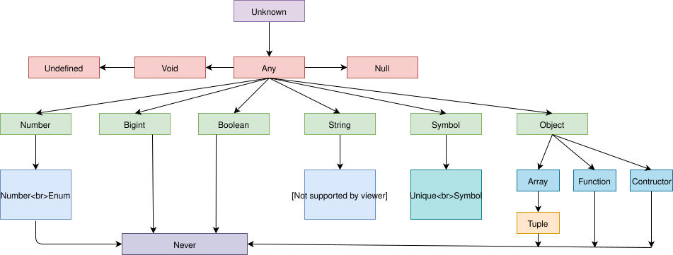

# TypeScript 数据类型

## 1 TypeScript 支持的数据类型

TypeScript 沿用了 ECMAScript 标准，类型有：

- 基础类型(7 个)：number、boolean、string、undefined、null、symbol、bigint
- 引用类型(1 个)：object（具体表现形式有 Class 类型、对象字面量、函数Function、数组Array、元素Tuple）
- 特殊类型(4 个)：
  - any： 表示任意类型，支持所有类型
  - unknown：表示未知类型，可以理解为一种类型安全的 any，是所有类型的顶级类型，无法直接使用，必须进行类型收窄(如 typeof 检查)
  - void：表示函数没有返回值，不过可以返回 undefined 等值
  - never：所有类型的底层类型，表示永不会发生的值，如：一个总是抛出异常或无线循环的函数，其返回类型是 never

如图所示：



boolean string number 这些类型在 TS 用法与 JS 一致，但是这里推荐声明该类型数据时让 TS 自动推导，而不是手动指定：

```ts
let b = '666' //ts推导为字符串
```

symbbol 类型也可以被推导，也可以显式声明 unique symbol：

```ts
let a: unique symbol = Symbol('hello')
let b: unique symbol = Symbol('hello')
console.log(a === b) // false
```

## 2 TypeScript 独有数据类型

### 2.1 any

any 表示任意可用类型，如果无法确认数据的类型在，则默认为 any。

比如在前端开发中通过 getElementById() 获取到的元素是个 object 类型，而 ts 没有该类型，直接赋值就会报错，可以使用 any 类型。

```ts
let num: any = 123
console.log(typeof num)
num = false
console.log(typeof num)
num = 'str'
console.log(typeof num)
```

注意：声明但未赋值的变量也是 any，如下所示：

```ts
let age // any 类型
age = 30 // 此时仍然是 any
```

any 是兜底的行为，需要尽量避免使用，因为 any 会让该变量的类型检查器无法发挥作用。如下所示，滥用any导致了编译器无法报错：

```ts
let a: any = 3
let b: any = ['err']

// 该语句不会报错了，因为是开发者主动告知了TS自己的行为是正常的
let c = a + b
```

如果想让 TS 避免上述错误，可以在 tsconfig 中启用 `noImplicitAny`，该属性隶属于 `strict`，如果启用了严格模式，则无需启用该属性。

### 2.2 元组 tuple

在 typescript 中可以直接使用 es5 的定义语法声明数组：

```ts
let arr1 = [1, 2, 'str'] //ES5 原生数组
```

一般情况下，数组应该保持元素类型相同，TS 也支持对数组类元素类型进行限定，一般在 TS 中使用数组采用下列方式：

```ts
let arr2: number[] = [1, 2, 3] //数组元素只能是数字
let arr3: Array<number> = [1, 2, 3] //数组元素只能是数字
```

TS 由于是 JS 的超集，所以也支持在数组中存储不同的数据类型，这种数据类型在大多编程语言中都称呼为元组（Tuple）。TS 中的元组类型表示一个**已知元素数量和类型**的数组，各元素的类型不必相同：

```ts
let tuple1: [number, string] = [1, 'aaa']

//报错 第二个元素应该是字符串且长度不对
let tuple2: [number, string] = [1, 2, 'aaa']
```

贴士：相较于数组，元组的性能更高，声明出来的元组推导的类型会是数组。

TS 也支持创建只读数组，只读数组无法执行 push、slice 等操作：

```ts
let arr1: readonly number[] = [1, 2, 3]
let arr2: ReadonlyArray<string> = ['a', 'b', 'c']
```

### 2.3 unknown

unknown 与 any 类似也表示任意值，但是 TS 会要求 unknow 的数据进行类型检查：

```ts
let data: unknown = [1, 2, 3]

// 必须判明类型后才能联想length属性
for (let i = 0; i < (data as Array<Number>).length; i++) {}
```

unknown 类型支持比较操作，如 `===`、`||`、`&&`、`?` 等，可以否定 `!`，也支持使用 `typeof`、`instanceof` 进行类型判定，如下所示：

```ts
let a: unknown = 30 // unknow

// 支持比较运算符
let b = a === 123 // boolean

// 不支持 + 类型运算符
// let c = a + 10  // Error: Object is of type 'unknown'

if (typeof a === 'number') {
  let d = a + 10
}
```

所以，当无法预知一个数据的类型时，才会考虑 unknow。TS 不会把任何值推导为 unknown 类型，必须显式声明。

注意：与 any 相关的数据都会被污染为 any 类型，而关键字 unknown 不会，如下所示：

```ts
// any 类型的 age 将 count 沾染为了 any
let age
age = 30
let count = age + 1 // count 也是 any

// unknown 只影响自己，不会污染其他人
let num: unknown
num = 30 // 此时仍然是 unknown
let result = num + 1 // 这里报错：运算符“+”不能应用于类型“unknown”和“1”
```

综上可以看出，unknown 类型不能直接使用，其本质是**类型安全的 any**，需要先进行类型判断、类型断言才能使用：

```js
let num: unknown
num = 30 // 此时仍然是 unknown

// 类型判断
if (typeof num === 'number') {
    let result = num + 1 // 这里报错
}

// 类型断言：直接告知编译器 num 类型是 number
let result1 :number = num as number + 1 // 断言方式一
let result2 :number = <number>num + 1   // 断言方式二
```

### 2.4 void 类型与 never 类型

在 JS 中 undefined 和 null 是比较特殊的类型，用于数据的缺失，在语义上有细微差别，如 undefined 表示未定义，null 表示没有值（例如在计算过程中出错了）。同时，undefined 类型只有 undefined 一个值，null 类型只有 null 一个值。

TS 为了表示数据缺失，又额外定义了 void、never 类型用来表示函数没有返回值：

- void 声明的函数中仍然可以返回 undefined 等数据
- never 则表示该函数绝对不会有返回值

```ts
// 一个返回null的函数
const fn1 = (num: number) => {
  if (num < 10) {
    return num
  }
  return null
}

// 一个返回void的函数: void 可以不写
const fn2 = (): void => {
  let a = 2 + 2
  console.log(a)
}

// 一个返回never的函数
const fn3 = () => {
  throw new Error('错误')
}
```

如果说 unknown 是每个类型的父类型，那么 never 类型是任何类型的子类型，可以赋值给任何类型，然而除了 never 本身之外，没有类型可以赋值给 never 类型（包括 any）。所以当变量被永不为真的类型保护所约束时使用时，该变量也可以是 never 类型。
