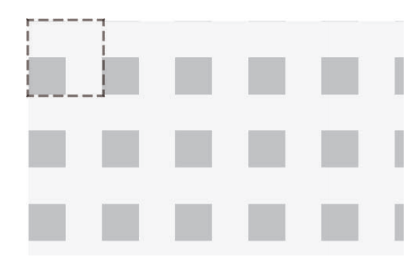
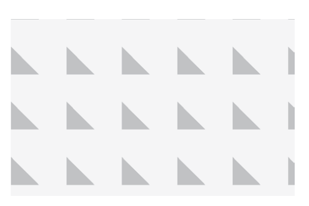
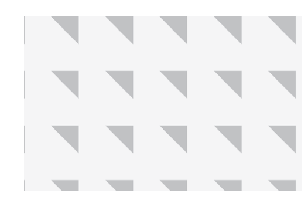
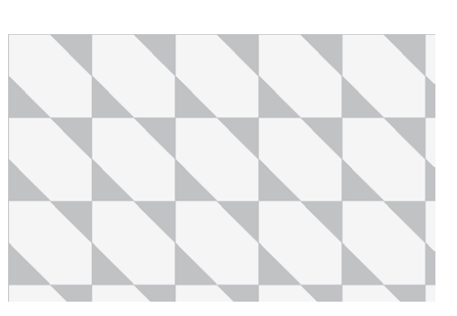
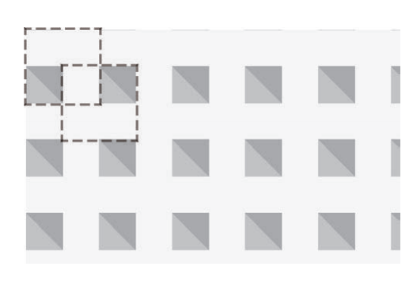
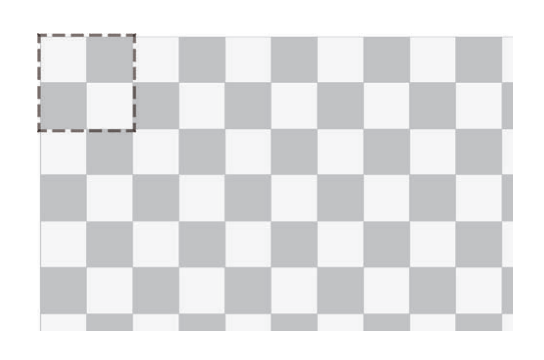
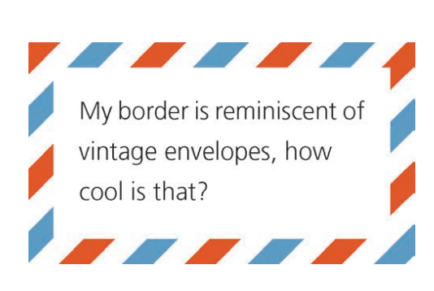

# 边框与背景

## 1 边框避免背景侵入

下列代码中，如果没有 background-clip ，那么这种透明边框是出不来的，因为背景会侵入边框。

```html
<div class="container">
  <div class="box">
    <p>Content</p>
  </div>
</div>

<style>
  border: 10px solid hsla(0, 0%, 100%, 0.5);
  background: white;
  background-clip: padding-box;
</style>
```

## 2 阴影多重边框

利用阴影可以制作多重边框效果，且不站稳位置：

```css
background: yellowgreen;
box-shadow:
  0 0 0 10px #655,
  0 0 0 15px deeppink,
  0 2px 5px 15px rgba(0, 0, 0, 0.6);
```

利用 outline 可以在边框上添加描边，制作 2 层边框效果：

```css
// 可以使用 outline-offset 控制描边距离
background: yellowgreen;
border: 10px solid #655;
outline: 5px solid deeppink;
```

## 3 背景与定位

background-position 可以修改背景图偏移位置：

```css
background: url(code-pirate.svg) no-repeat #58a;
background-position: right 20px bottom 10px;
```

这种偏移是以 padding box 为准的，这样边框才不会遮住背景图片。因此，top left 默认指的是 padding box 的左上角。

使用 background-origin 可以修改边缘基准，值可以是： content-box;

calc() 也可以是一种偏移方案：

```css
background: url('code-pirate.svg') no-repeat;
background-position: calc(100% - 20px) calc(100% - 10px);
```

## 4 条纹

利用背景渐变可以制作条纹：

```css
// 渐变
background: linear-gradient(#fb3, #58a);

// 拉近渐变
background: linear-gradient(#fb3 20%, #58a 80%);

// 渐变消失，成为条纹:颜色突然变化，而不是一个平滑的渐变过程
background: linear-gradient(#fb3 50%, #58a 50%);

// 接着将背景大小修改为长条形
background: linear-gradient(#fb3 50%, #58a 50%);
background-size: 100% 30px;

// 多个条纹在一起
background: linear-gradient(#fb3 30%, #58a 30%);
background-size: 100% 30px;

// 把第二个色标的位置值设置为 0，那它的位置就总是会被浏览器调整为前一个色标的位置值
background: linear-gradient(#fb3 30%, #58a 0);
background-size: 100% 30px;

// 三种颜色的条纹
background: linear-gradient(#fb3 33.3%, #58a 0, #58a 66.6%, yellowgreen 0);
background-size: 100% 45px;

// 垂直条纹
background: linear-gradient(to right, #fb3 50%, #58a 0);  /* 或 90deg */
background-size: 30px 100%;

// 斜向条纹
background: linear-gradient(45deg,
 #fb3 25%, #58a 0, #58a 50%,
 #fb3 0, #fb3 75%, #58a 0);
background-size: 30px 30px;
// 根据勾股定理，斜向条纹要保持和之前的一致不能是 30px，而是 42px

// 斜向条纹的优雅创建方案
background: repeating-linear-gradient(45deg,
 #fb3, #fb3 15px, #58a 0, #58a 30px);

//  重复线性渐变图案
background: linear-gradient(45deg,
 #fb3, #58a 30px,
 #fb3 30px, #58a 60px,
 #fb3 60px, #58a 90px,
 #fb3 90px, #58a 120px,
 #fb3 120px, #58a 150px, ...);

// 新版斜向条纹语法
background: repeating-linear-gradient(60deg, #fb3 0 15px, #58a 0 30px);

// 同色系条纹
background: repeating-linear-gradient(30deg,#79b, #79b 15px, #58a 0, #58a 30px);
```

## 5 渐变制作背景图

单一一个渐变无法制作复杂图形，而将多个渐变组合就可以达到意想不到的效果：

### 5.1 实现网格效果

是把水平和垂直的条纹叠加起来，制作网格：

```css
background: white;
background-image:
  linear-gradient(90deg, rgba(200, 0, 0, 0.5) 50%, transparent 0),
  linear-gradient(rgba(200, 0, 0, 0.5) 50%, transparent 0);
background-size: 30px 30px;
```

如果网格中每个格子的大小可以调整，而网格线条的粗细同时保持固定，实现类似图纸辅助线的网格：

```css
// 长度替代百分比
background: #58a;
background-image:
 linear-gradient(white 1px, transparent 0),
 linear-gradient(90deg, white 1px, transparent 0);
background-size: 30px 30px;
```

至可以把两幅不同线宽、不同颜色的网格图案叠加起来，得到一个更加逼真的蓝图网格：

```css
background: #58a;
background-image:
  linear-gradient(white 2px, transparent 0),
  linear-gradient(90deg, white 2px, transparent 0),
  linear-gradient(hsla(0, 0%, 100%, 0.3) 1px, transparent 0),
  linear-gradient(90deg, hsla(0, 0%, 100%, 0.3) 1px, transparent 0);
background-size:
  75px 75px,
  75px 75px,
  15px 15px,
  15px 15px;
```

### 5.2 波点

径向渐变能够一个圆点的阵列：

```css
background: #655;
background-image: radial-gradient(tan 30%, transparent 0);
background-size: 30px 30px;
```

接着生成两层圆点阵列图案，并把它们的背景定位错开，这样就可以得到真正的波点图案：

```css
background: #655;
background-image:
  radial-gradient(tan 30%, transparent 0),
  radial-gradient(tan 30%, transparent 0);
background-size: 30px 30px;
background-position:
  0 0,
  15px 15px;
```

贴士：为了达到效果，第二层背景的偏移定位值必须是贴片宽高的一半，利用变量：

```css
.polka {
  /* 定义变量并给予默认值（类似 Sass 的默认参数） */
  --size: 30px;
  --dot: 30%;
  --base: #655;
  --accent: tan;

  /* 使用 var() 调用变量，计算位置时用 calc() */
  background: var(--base);
  background-image:
    radial-gradient(var(--accent) var(--dot), transparent 0),
    radial-gradient(var(--accent) var(--dot), transparent 0);
  background-size: var(--size) var(--size);
  background-position:
    0 0,
    calc(var(--size) / 2) calc(var(--size) / 2);
}
```

### 5.3 国际象棋棋盘

棋盘图案是可以通过平铺生成的，平铺成这个图案的典型贴片包含两种不同颜色的方块，且相互间隔。在技术上，我们可以用 CSS 渐变来创建平铺的方块，但每个方块的周围是不会有空隙的，因此最终的结果看起来就是一片实色。总的来说，只用一层 CSS 渐变无法创建四周有空隙的方块。

用两个直角三角形可以拼合出我们想要的方块，下面是创建直角三角形的代码：

```css
background: #eee;
background-image: linear-gradient(45deg, #bbb 50%, transparent 0);
background-size: 30px 30px;
```



如果我们把这些三角形的直角边缩短到原来的一半，从而只占据贴片面积的 8分之 1，而不是 2 分之 1，只需简单地把色标的位置值从 50% 改为 25% ：



如果我们把色标的顺序反转，就可以创建相反方向的三角形：

```css
background: #eee;
background-image: linear-gradient(45deg, transparent 75%, #bbb 0);
background-size: 30px 30px;
```



把它们组合在一起：

```css
background: #eee;
background-image:
  linear-gradient(45deg, #bbb 25%, transparent 0),
  linear-gradient(45deg, transparent 75%, #bbb 0);
background-size: 30px 30px;
```



把第二层渐变在水平和垂直方向均移动贴片长度的一半，就可以把它们拼合成一个完整的方块：

```css
background: #eee;
background-image:
  linear-gradient(45deg, #bbb 25%, transparent 0),
  linear-gradient(45deg, transparent 75%, #bbb 0);
background-position:
  0 0,
  15px 15px;
background-size: 30px 30px;
```



目前实现了棋盘的一半，接着把现有的这一组渐变重复一份，从而创建出另一组正方形，并且偏移它们的定位值，棋盘效果就实现了：

```css
background: #eee;
background-image:
  linear-gradient(45deg, #bbb 25%, transparent 0),
  linear-gradient(45deg, transparent 75%, #bbb 0),
  linear-gradient(45deg, #bbb 25%, transparent 0),
  linear-gradient(45deg, transparent 75%, #bbb 0);
background-position:
  0 0,
  15px 15px,
  15px 15px,
  30px 30px;
background-size: 30px 30px;
```



这段代码还可以稍稍优化，比如我们可以把这些处在贴片顶角的三角形两两组合起来（即把第一组和第二组合并为一层渐变，把第三组和第四组合并为一层渐变），然后还可以把深灰色改成半透明的黑色——这样我们只需要修改底色就可以改变整个棋盘的色调，不需要单独调整各层渐变的色标了：

```css
background: #eee;
background-image:
  linear-gradient(
    45deg,
    rgba(0, 0, 0, 0.25) 25%,
    transparent 0,
    transparent 75%,
    rgba(0, 0, 0, 0.25) 0
  ),
  linear-gradient(
    45deg,
    rgba(0, 0, 0, 0.25) 25%,
    transparent 0,
    transparent 75%,
    rgba(0, 0, 0, 0.25) 0
  );
background-position:
  0 0,
  15px 15px;
background-size: 30px 30px;
```

当然，SVG 方案也是可行的。还有更现代化的方案：成角向渐变（也称作圆锥渐变）。这种渐变的效果通常看起来像是一个俯视的圆锥体，所有色标的颜色变化是由一条射线绕着端点旋转来推进的。以下渐变代码可以创建一个色轮：

```css
background: conic-gradient(red, yellow, lime, aqua, blue, fuchsia, red);
```

除了色轮之外，角向渐变还可以实现放射状的光芒、金属拉丝效果，以及其他各种各样的背景：

```css
background: repeating-conic-gradient(#bbb 0, #bbb 25%, #eee 0, #eee 50%);
background-size: 30px 30px;
```

## 6 图像应用为边框

border-image 可以将图像应用为边框，但是也会存在一些问题，因为其原理是九宫格伸缩法：把图片切割成九块，然后把它们应用到元素边框相应的边和角。这也导致其无法适配尺寸稍有差异的其他元素，比如不想让图片的某个特定部分固定在拐角处；而是希望出现在拐角处的图片区域是随着元素宽高和边框厚度的变化而变化的。

简单方案就是写 2 个元素，一个负责放置背景图，一个负责放内容，且覆盖在上面。但是其实还可以只用一个元素实现，

思路就是在背景图片之上，再叠加一层纯白的实色背景。为了让下层的图片背景透过边框区域显示出来，我们需要给两层背景指定不同的 background-clip 值。最后一个要点在于，我们只能在多重背景的最底层设置背景色，因此需要用一道从白色过渡到白色的 CSS 渐变来模拟出纯白实色背景的效果：

```css
padding: 1em;
border: 1em solid transparent;
background: linear-gradient(white, white), url(stone-art.jpg);
background-size: cover;
background-clip: padding-box, border-box;
background-origin: border-box;
```

优化整合后的代码：

```css
padding: 1em;
border: 1em solid transparent;
background:
  linear-gradient(white, white) padding-box,
  url(stone-art.jpg) border-box 0 / cover;
```

这个技巧还可以用在渐变图案上，如实现老式信封样式的边框：

```css
padding: 1em;
border: 1em solid transparent;
background:
  linear-gradient(white, white) padding-box,
  repeating-linear-gradient(
      -45deg,
      red 0,
      red 12.5%,
      transparent 0,
      transparent 25%,
      #58a 0,
      #58a 37.5%,
      transparent 0,
      transparent 50%
    )
    0 / 5em 5em;
```



还可以实现行军蚁边框，这个效果在很多图像编辑软件中使用。这里条纹转变为黑白两色，并把边框的宽度减少至 1px，然后再把 background-size 改为某个合适的值。最后把 background-position 以动画的方式改变为 100%，就可以让它滚动起来了：

```css
@keyframes ants {
  to {
    background-position: 100%;
  }
}
.marching-ants {
  padding: 1em;
  border: 1px solid transparent;
  background:
    linear-gradient(white, white) padding-box,
    repeating-linear-gradient(-45deg, black 0, black 25%, white 0, white 50%)
      0 / 0.6em 0.6em;
  animation: ants 12s linear infinite;
}
```

当然，border-image 在搭配渐变图案时也有其强大之处，如：我们需要一个顶部边框被裁切的效果，就像一般的脚注那样，这时候用 border-image 属性再加上一条由渐变生成的垂直条纹，并把要裁切的长度在渐变中写好。边框线的粗细交给border-width 来控制：

```css
border-top: 0.2em solid transparent;
border-image: 100% 0 0 linear-gradient(90deg, currentColor 4em, transparent 0);
padding-top: 1em;
```
