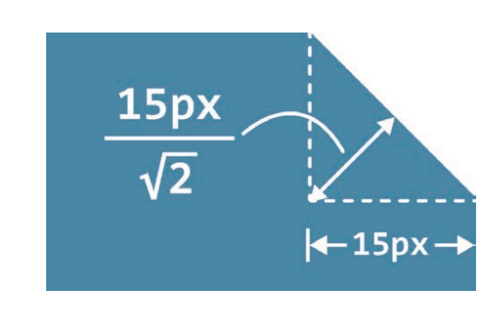
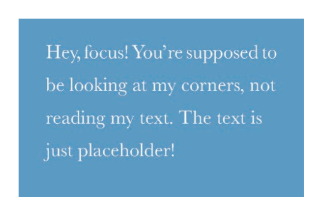
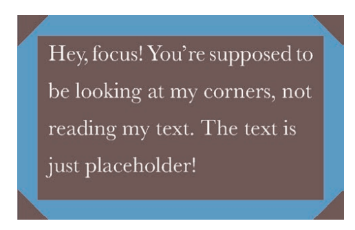
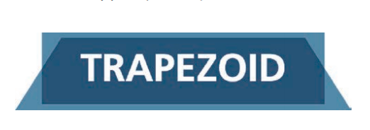
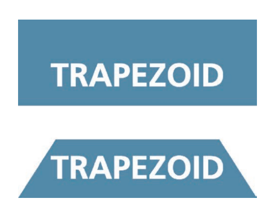
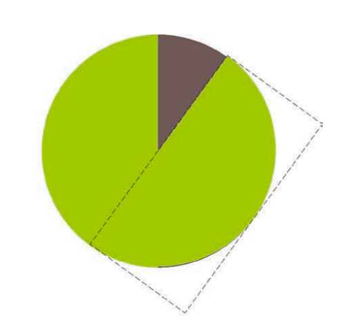
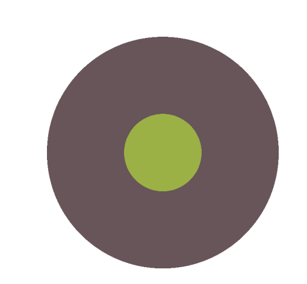
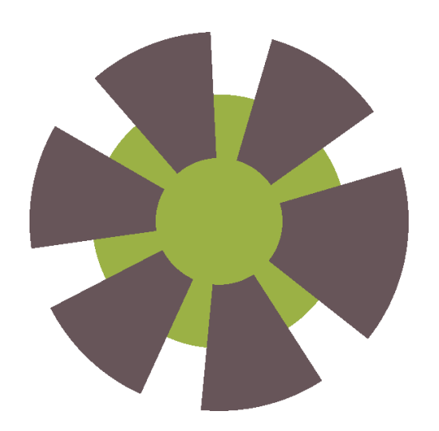
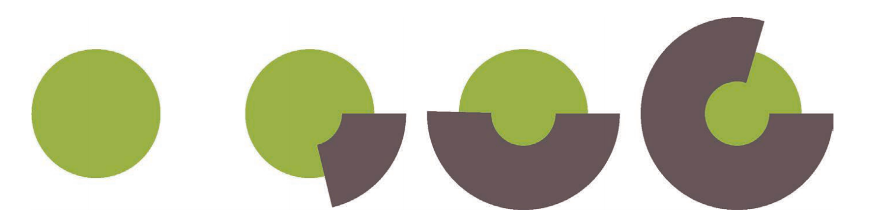

# 形状

## 1 椭圆

```css
// 实现一个自适应椭圆
border-radius: 50%;

// 自适应半椭圆:从左上角开始以顺时针顺序应用到元素的各个拐角
border-radius: 50% / 100% 100% 0 0;

// 沿纵轴劈开的半椭圆
border-radius: 100% 0 0 100% / 50%;

// 四分之一椭圆
border-radius: 100% 0 0 0;
```

## 2 平行四边形

实现平行四边形必须要保证图形倾斜、文字内容不会随着图形倾斜而改变：

```html
<a href="#yolo" class="button"> <div>Click me</div> </a>

<style>
  // 必须两次  skewX ，以保证文字恢复到原样
  .button {
    transform: skewX(-45deg);
  }

  .button > div {
    transform: skewX(45deg);
  }
</style>
```

上述用到了 2 个元素，可以用位元素方案来优化，把所有样式（背景、边框等）应用到伪元素上，然后再对伪元素进行变形。因为我们的内容并不是包含在伪元素里的，所以内容并不会受到变形的影响

```css
.button {
  position: relative;
  /* 其他的文字颜色、内边距等样式…… */
}
.button::before {
  content: ''; /* 用伪元素来生成一个矩形 */
  position: absolute;
  top: 0;
  right: 0;
  bottom: 0;
  left: 0;
  z-index: -1;  //避免伪元素生成的方块是重叠在内容之上的
  background: #58a;
  transform: skew(45deg);
}
```

## 3 菱形

方案一：需要把图片用一个 div 包裹起来，然后对其应用相反的 rotate()变形样式。

```html
<div class="picture">
  
</div>

<style>
  .picture {
    width: 400px;
    transform: rotate(45deg);
    overflow: hidden;
  }
  .picture > img {
    max-width: 100%;
    transform: rotate(-45deg);
  }
</style>
```

此时实现了一个八边形，需要在此基础上进行裁剪。主要问题在于 max-width: 100% 这条声明。100% 会被解析为容器（.picture）的边长。但是，我们想让图片的宽度与容器的对角线相等，而不是与边长相等。利用勾股定理计算出边长 。因此，把 max-width 的值设置为 边长\*100% 是很合理的，或者把这个值向上取整为 142%，因为我们不希望因为计算的舍入问题导致图片在实际显示时稍小。如果用 scale() 变形样式来把这个图片放大，实际上会更加合理：

- 我们希望图片的尺寸属性保留 100% 这个值，这样当浏览器不支持变形样式时仍然可以得到一个合理的布局。
- 通过 scale() 变形样式来缩放图片时，是以它的中心点进行缩放的（除非我们额外指定了 transform-origin 样式）。通过 width 属性来放大图片时，只会以它的左上角为原点进行缩放，从而迫使我们动用额外的负外边距来把图片的位置调整回来。

```css
.picture {
  width: 400px;
  transform: rotate(45deg);
  overflow: hidden;
}
.picture > img {
  max-width: 100%;
  transform: rotate(-45deg) scale(1.42);
}
```

上面的方法确实可以奏效，但它基本上是一个 hack。这个方法需要一层额外的 HTML 标签，这不够简洁；代码本身也不够直观；它甚至还不够健壮——如果我们碰巧要处理一张非正方形的图片，就不行了。

方案二：使用 polygon()（多边形）函数来指定一个菱形。函数允许用一系列（以逗号分隔的）坐标点、百分比值来指定任意的多边形：

```css
img {
  clip-path: polygon(50% 0, 100% 50%, 50% 100%, 0 50%);
  transition: 1s clip-path;
}
img:hover {
  clip-path: polygon(0 0, 100% 0, 100% 100%, 0 100%);
}
```

## 4 切角

切角：矩形的两端一侧改变为三角形，在一些导航中经常使用。

### 4.1 渐变方案

方案一：使用线性渐变，把一个透明色标放在切角处，然后在相同位置设置另一个色标，并且把它的颜色设置为我们想要的背景色即可：

```css
background: linear-gradient(-45deg, transparent 15px, #58a 0);
```

如果需要切掉 2 个角，就需要 2 个渐变，但是 2 个渐变会互相覆盖！！！必须使用background-size 让每层渐变分别只占据整个元素一半的面积：

```css
background:
  linear-gradient(-45deg, transparent 15px, #58a 0) right,
  linear-gradient(45deg, transparent 15px, #655 0) left;
background-size: 50% 100%;
background-repeat: no-repeat;   // 默认会平铺 2 次，所以必须去除平铺
```

如果需要切掉 4 个角：

```css
background:
  linear-gradient(135deg, transparent 15px, #58a 0) top left,
  linear-gradient(-135deg, transparent 15px, #58a 0) top right,
  linear-gradient(-45deg, transparent 15px, #58a 0) bottom right,
  linear-gradient(45deg, transparent 15px, #58a 0) bottom left;
background-size: 50% 50%;
background-repeat: no-repeat;
```

如果需要弧形切角：

```css
background:
  radial-gradient(circle at top left, transparent 15px, #58a 0) top left,
  radial-gradient(circle at top right, transparent 15px, #58a 0) top right,
  radial-gradient(circle at bottom right, transparent 15px, #58a 0) bottom right,
  radial-gradient(circle at bottom left, transparent 15px, #58a 0) bottom left;
background-size: 50% 50%;
background-repeat: no-repeat;
```

### 4.2 内联 SVG 与 border-image 方案

使用 border-image，并通过一个内联的 SVG 图像也可以产生切角效果：由于尺寸无关紧要（border-image 会解决缩放问题，而 SVG 可以实现与尺寸完全无关的完美缩放——这就是矢量图的好处），每个切片的尺寸都可以设置为 1，以便理解和书写。切角的尺寸是 1，直线边缘也都是 1。

```css
border: 15px solid transparent;
border-image: 1 url('data:image/svg+xml,\
 <svg xmlns="http://www.w3.org/2000/svg"
 width="3" height="3" fill="%2358a">\
 <polygon points="0,1 1,0 2,0 3,1 3,2 2,3 1,3 0,2"/>\
 </svg>');
```

注意：切片尺寸是 1。这并不表示 1 像素；它所对应的是SVG 文件的坐标系统，如果用百分比来指定这些长度，就只能采用 33.34% 这样的值来近似地获得图像尺寸的三分之一，而近似值都是有风险的。

这里的 15px 实际效果要比方案一中的 15px 小，因为在渐变中，这个 15px 是沿着渐变轴来度量的，它的方向与渐变推进的方向一致。边框宽度并不是斜向度量的，而是以水平或垂直方向来度量的。



如图所示，真实的斜边宽度近似为：$15 \times \sqrt{2} \approx 20$：

```css
border: 20px solid transparent;
border-image: 1 url('data:image/svg+xml,\
 <svg xmlns="http://www.w3.org/2000/svg"
 width="3" height="3" fill="%2358a">\
 <polygon points="0,1 1,0 2,0 3,1 3,2 2,3 1,3 0,2"/>\
 </svg>');
```

此时切角效果没了：


换下背景色就会发现切角的位置：


这是因为背景色和切角边框混在了一起，使用 background-clip 可以避免背景色蔓延到边框区域：

```css
border: 20px solid transparent;
border-image: 1 url('data:image/svg+xml,\
 <svg xmlns="http://www.w3.org/2000/svg"\
 width="3" height="3" fill="%2358a">\
 <polygon points="0,1 1,0 2,0 3,1 3,2 2,3 1,3 0,2"/>\
 </svg>');
background: #58a;
background-clip: padding-box;
```

对比方案一的好处：

- 支持动画：border-width 属性支持动画
- 改变切角只需要一处代码

缺点：改变背景色比较麻烦。

### 4.3 方案三：裁切路径

方案二使用 border-image 需要指定某个实色的背景，或者指定一个边缘接近某个实色的背景图案。假如我们想设置其他类型的背景（比如纹理、平铺图案或一道线性渐变），就需要另辟蹊径，使用裁切路径方案。

用裁切路径将一个元素切出 20px 大小：

```css
background: #58a;
clip-path: polygon(
  20px 0,
  calc(100% - 20px) 0,
  100% 20px,
  100% calc(100% - 20px),
  calc(100% - 20px) 100%,
  20px 100%,
  0 calc(100% - 20px),
  0 20px
);
```

这个方法最大的好处在于，我们可以使用任意类型的背景，甚至可以对替换元素（比如图片）进行裁切。此外，这种方法还支持动画效果，不仅可以用动画的方式来改变切角的尺寸，还可以彻底变换裁切形状，只需要为动画的终止状态指定另一条裁切路径即可。

注意：使用裁切后，当内边距不够宽时，它会裁切掉文本，因为它只能对元素做统一的裁切，并不能区分元素的各个部分。与此不同的是，渐变方案允许文字溢出并超出切角区域（因为它只是背景图案）；而 border-image 方案则会起到普通边框的作用，令文字折行。

### 4.4 方案四：终极方案 corner-shape

若浏览器支持 corner-shape，则可以使用该属性：

```css
border-radius: 15px;
corner-shape: bevel;
```

## 5 梯形

边框可以用用来模拟梯形，该方案会将这个元素的 2 个位元素同时用上，且在样式层面上也不够灵活，如：当我们要给梯形标签页增加一圈边框、一层纹理背景，或者要在其顶部设置圆角...

思路：如果将矩形按照 3D 方向 的 Z 轴旋转，人类视觉上就会看到梯形，但是文字也跟着发生了边形，由于 3D 边形不可逆转，所以需要解决文字问题：

```css
transform: perspective(0.5em) rotateX(5deg);
```

唯一可行的途径就是把变形效果作用在伪元素上：

```css
.tab {
  position: relative;
  display: inline-block;
  padding: 0.5em 1em 0.35em;
  color: white;
}
.tab::before {
  content: ''; /* 用伪元素来生成一个矩形 */
  position: absolute;
  top: 0;
  right: 0;
  bottom: 0;
  left: 0;
  z-index: -1;
  background: #58a;
  transform: perspective(0.5em) rotateX(5deg);
}
```

当我们没有设置 transform-origin 属性时，应用变形效果会让这个元素以它自身的中心线为轴进行空间上的旋转。因此，元素投射到 2D 屏幕上的尺寸会发生多种变化，如图所示：它
的宽度会增加，它所占据的位置会稍稍下移，它在高度上会有少许缩减，等等。这些变化导致它在设计上很难控制。



我们可以为它指定 transform-origin:bottom;，当它在 3D 空间中旋转时，可以把它的底边固定住，此时只有高度会发生变化。不过这样一来，高度的缩水会变得更加显眼，因为现在整个元素是转离屏幕
前的观众的；而在之前，元素的上半部分会转向屏幕后面，下半部分会转出屏幕。相比之下，在 3D 空间中，之前的元素总体上是离观众更近的。为我们可能会想到给元素增加额外的顶部内边距。不过在那些不支持 3D 变形的浏览器中，结果看起来会很怪异：



其实可以通过变形属性来改变它的尺寸，如果浏览器不支持 3D 变形，则所有的变形属性都会被丢弃，从而显示出它朴素的本来面目。如下所示：垂直方向上的缩放程度（也就是
scaleY() 变形属性）在达到 130% 左右时刚好可以补足它在高度上的缩水：

```css
transform: scaleY(1.3) perspective(0.5em) rotateX(5deg);
transform-origin: bottom;
```

这种方案下，可以为梯形元素添加很多新样式：

```css
nav > a {
  position: relative;
  display: inline-block;
  padding: 0.3em 1em 0;
}
nav > a::before {
  content: '';
  position: absolute;
  top: 0;
  right: 0;
  bottom: 0;
  left: 0;
  z-index: -1;
  background: #ccc;
  background-image: linear-gradient(
    hsla(0, 0%, 100%, 0.6),
    hsla(0, 0%, 100%, 0)
  );
  border: 1px solid rgba(0, 0, 0, 0.4);
  border-bottom: none;
  border-radius: 0.5em 0.5em 0 0;
  box-shadow: 0 0.15em white inset;
  transform: perspective(0.5em) rotateX(5deg);
  transform-origin: bottom;
}
```

## 6 饼图

### 6.1 方案一

基础圆形，且利用渐变将圆形分为左右两半：

```css
.pie {
  width: 100px;
  height: 100px;
  border-radius: 50%;
  background: yellowgreen;
  background-image: linear-gradient(to right, transparent 50%, #655 0);
}
```

接着设置伪元素的样式，让它起到遮盖层的作用：

```css
.pie::before {
  content: '';
  display: block;
  margin-left: 50%;
  height: 100%;
  border-radius: 0 100% 100% 0 / 50%;   // 做成半圆以避免位元素默认的矩形样式突破饼状图范围（当然也可以给父元素 pie 设置 overflow:hidden）
  background-color: inherit;
  // 希望伪元素绕着圆心旋转
  transform-origin: left;
  transform: rotate(.1turn);
}
```



添加 CSS 动画来实现一个饼图从 0 变化到 100% 的动画，制作一个旋转指示器：

```css
@keyframes spin {
  to {
    transform: rotate(0.5turn);
  }
}
@keyframes bg {
  50% {
    background: #655;
  }
}
.pie::before {
  content: '';
  display: block;
  margin-left: 50%;
  height: 100%;
  border-radius: 0 100% 100% 0 / 50%;
  background-color: inherit;
  transform-origin: left;
  animation:
    spin 3s linear infinite,
    bg 6s step-end infinite;
}
```

如果想做一个通用代码，如：

```html
<div class="pie">20%</div>
<div class="pie">60%</div>
```

就能实现2种不同的饼图，一个展示为 20%，另一个展示为 60%。这里可以使用暂停动画：用负的动画延时来直接跳至动画中的任意时间点，并且定格在那里。

因为我们的动画是暂停的，所以动画的第一帧（由负的 animation-delay 值定义）将是唯一显示出的那一帧。在饼图上显出的比率就是我们的animation-delay 值在总的动画持续时间中所占的比率。举例来说，如果动画持续时间定为 6s，我们只需要把 animation-delay 设置为 -1.2s，就能显示出 20% 的比率。为了简化这个计算过程，我们可以设置一个长达 100s的持续时间。别忘了，这里的动画是永远处在暂停状态的，因此我们指定的持续时间并不会产生其他副作用。

现在还剩最后一个问题：动画是作用在伪元素上的，但我们希望最终内联样式可以设置在 .pie 元素上。不过，由于 `<div>` 上并没有任何动画效果，我们可以用内联样式的方式为其设置 animation-delay 属性，然后再在伪元素上应用 animation-delay: inherit; 属性。综合以上要素，如果要让饼图显示为 20% 和 60%，则代码为：

```html
<div class="pie" style="animation-delay: -20s"></div>
<div class="pie" style="animation-delay: -60s"></div>

<style>
  @keyframes spin {
    to {
      transform: rotate(0.5turn);
    }
  }
  @keyframes bg {
    50% {
      background: #655;
    }
  }
  .pie {
    position: relative;
    width: 100px;
    line-height: 100px;
    border-radius: 50%;
    background: yellowgreen;
    background-image: linear-gradient(to right, transparent 50%, #655 0);
    color: transparent;
    text-align: center;
  }
  @keyframes spin {
    to {
      transform: rotate(0.5turn);
    }
  }
  @keyframes bg {
    50% {
      background: #655;
    }
  }

  .pie::before {
    content: '';
    position: absolute;
    top: 0;
    left: 50%;
    width: 50%;
    height: 100%;
    border-radius: 0 100% 100% 0 / 50%;
    background-color: inherit;
    transform-origin: left;
    animation:
      spin 50s linear infinite,
      bg 100s step-end infinite;
    animation-play-state: paused;
    animation-delay: inherit;
  }
</style>
```

### 6.2 方案二 SVG

可以用纯粹的矢量路径来绘制饼图，但是还有更巧妙的办法。

先制作一个带秒表的圆形：

```html
<svg width="100" height="100">
  <circle r="30" cx="50" cy="50" />
</svg>

<style>
  circle {
    fill: yellowgreen;
    stroke: #655;
    stroke-width: 30;
  }
</style>
```



stroke-dasharray也是 SVG 描边属性之一，用来实现为虚线描边：

```css
// 让虚线的线段长度为 20 且间隙长度为 10
stroke-dasharray: 20 10;
```



把虚线描边的线段长度指定为 0，并且把虚线间隙的长度设置为等于或大于整个圆周的长度:C= 2π × 30 ≈ 189，不同的 stroke-dasharray 值及其效果；从左到右分别是：0、189、40 189、95 189 和 150 189：



如果我们把这个圆形的半径减小到一定程度，它就会被描边完全覆盖，而我们最终会得到一个非常接近饼图的图形。举例来说，当我们把圆形的半径设为 25 并且把 stroke-width指定为 50 时：

```html
<svg width="100" height="100">
  <circle r="25" cx="50" cy="50" />
</svg>
<style>
  circle {
    fill: yellowgreen;
    stroke: #655;
    stroke-width: 50;
    stroke-dasharray: 60 158; /* 2π × 25 ≈ 158 */
  }
</style>
```

只需要在描边的下层再绘制一个稍大些的圆形，然后把描边以逆时针方向旋转 90°，以便让扇区的起点出现在最顶部，就可以做出真正的饼图了：

```css
svg {
  transform: rotate(-90deg);
  background: yellowgreen;
  border-radius: 50%;
}
```

要实现100% 的动画变得更加简单。我们只需要新建一个 CSS 动画，并把 stroke-dasharray 属性从 0 158 变化到 158 158 就可以了：

```css
@keyframes fillup {
  to {
    stroke-dasharray: 158 158;
  }
}
circle {
  fill: yellowgreen;
  stroke: #655;
  stroke-width: 50;
  stroke-dasharray: 0 158;
  animation: fillup 5s linear infinite;
}
```

还可以继续优化，给这个圆形指定一个特定的半径，从而让它的周长无限接近 100，这样就可以直接把比率的百分比值指定为 stroke-dasharray 的长度，不需要做任何计算了。因为周长是 2πr，半径就是
100/2π，我们最终把这个值取整为 16，还可以在 SVG 的viewBox 属性中指定其尺寸，而不再使用 width 和 height 属性，这样就可以让它自动适应容器的大小了：

```html
<svg viewBox="0 0 32 32">
  <circle r="16" cx="16" cy="16" />
</svg>
<style>
  svg {
    width: 100px;
    height: 100px;
    transform: rotate(-90deg);
    background: yellowgreen;
    border-radius: 50%;
  }
  circle {
    fill: yellowgreen;
    stroke: #655;
    stroke-width: 32;
    stroke-dasharray: 38 100; /* 可得到比率为38%的扇区 */
  }
</style>
```

### 6.3 方案三 角性渐变

在生成饼图时只需要一个圆形元素，再配上一幅具有两个色标的角向渐变即可：

```css
.pie {
  width: 100px;
  height: 100px;
  border-radius: 50%;
  background: conic-gradient(#655 40%, yellowgreen 0);
}
```

可以在饼图中添加颜色：

```css
background: conic-gradient(deeppink 20%, #fb3 0, #fb3 30%, yellowgreen 0);
```
