# 视觉效果

## 1 单测投影

box-shadow 的原理：

```css
box-shadow: 2px 3px 4px rgba(0, 0, 0, 0.5);
```

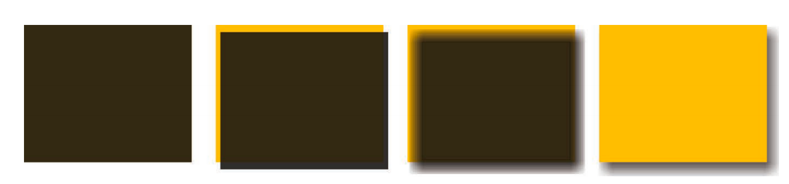

图中的一步步拆解为：

- 以该元素相同的尺寸和位置，画一个 rgba(0,0,0,.5) 的矩形。
- 把它向右移 2px，向下移 3px。
- 使用高斯模糊算法（或类似算法）将它进行 4px 的模糊处理。这在本质上表示在阴影边缘发生阴影色和纯透明色之间的颜色过渡长度近似于模糊半径的两倍（比如在这里是 8px）。
- 模糊后的矩形与原始元素的交集部分会被切除掉，因此它看起来像是在该元素的“后面”。这跟大多数开发者所理解的情况（元素叠在模糊后矩形的上层）可能稍有不同。不过，在某些场景下，意识到没有任
  何投影绘制在元素的下层十分重要。举例来说，如果给元素设置一层半透明的背景，我们就看不到它下层有任何投影。这一点跟 text-shadow 不同，因为文字下层的投影不会被裁切。

使用 4px 的模糊半径意味着投影的尺寸会比元素本身的尺寸大约 8px，因此投影的最外圈会从元素的四面向外显露出来1。我们只需改变偏移量，就可以把投影的顶部和左侧隐藏起来，只要这两个方向上的偏移量不小于
4px 就可以了。但是，这在某种程度上会导致外露的投影太过浓重，看起来不是很美观，且投影只出现在了单侧（而不是相邻的两侧）。

最终的解决方案来自 box-shadow 鲜为人知的第四个长度参数。它排在模糊半径参数之后，称作扩张半径。这个参数会根据你指定的值去扩大或（当指定负值时）缩小投影的尺寸。举例来说，一个 -5px 的扩张半径会把投影的宽度和高度各减少 10px（即每边各 5px）。

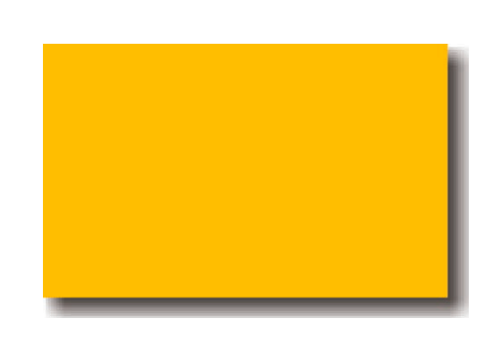

从逻辑上来说，如果我们应用一个负的扩张半径，而它的值刚好等于模糊半径，那么投影的尺寸就会与投影所属元素的尺寸完全一致。除非用偏移量（前两个长度参数）来移动它，我们将完全看不见任何投影。因此，如果给投影应用一个正的垂直偏移量，我们就会在元素的底部看到一道投影，而元素的另外三侧是没有投影的：

```css
box-shadow: 0 5px 4px -4px black;
```

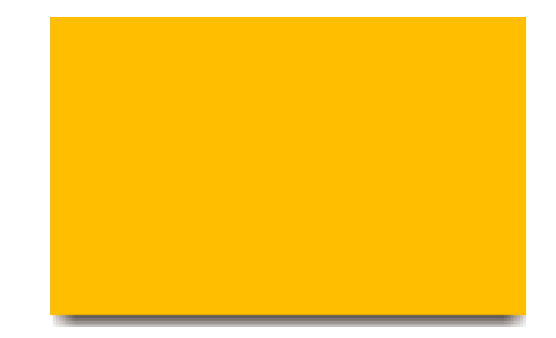

## 2 元素邻边投影

如果这两条边是相邻的（比如右侧和底部）：

- 不应该把投影缩得太小，而是只需把阴影藏进一侧，另一侧自然露出就好。因此，扩张半径不应设为模糊半径的相反值，而应该是这个相反值的一半。
- 需要指定两个偏移量，因为我们希望投影在水平和垂直方向上同时移动。它们的值需要大于或等于模糊半径的一半，因为我们希望把投影藏进另外两条边之内。

```css
box-shadow: 3px 3px 6px -3px black;
```

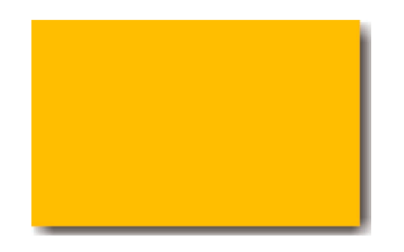

## 3 元素两侧投影

因为扩张半径在四个方向上的作用是均等的（也就是说，我们无法指定投影在水平方向上放大，而在垂直方向上缩小）1，唯一的办法是用两块投影（每边各一块）来达到目的。然后基本上就是把“单侧投影”中的技巧运用两次：

```css
box-shadow:
  5px 0 5px -5px black,
  -5px 0 5px -5px black;
```

## 4 不规则投影

矩形或 border-radius 生成的形状，内部的 box-shadow 能正确渲染，但当元素添加了一些伪元素或半透明的装饰之后， border-radius 会无忽视透明部分，如：

- 半透明图像、背景图像、或者 border-image（比如老式的金质像框）；
- 元素设置了点状、虚线或半透明的边框，但没有背景（或者当background-clip 不是 border-box 时）；
- 对话气泡，其小尾巴通常是用伪元素生成的
- 我们在“切角效果”一节中见过的切角形状
- 几乎所有的折角效果
- 通过 clip-path 生成的形状

对这类元素直接应用 `box-shadow:2px 2px 10px rgba(0,0,0,.5)`，效果如图：

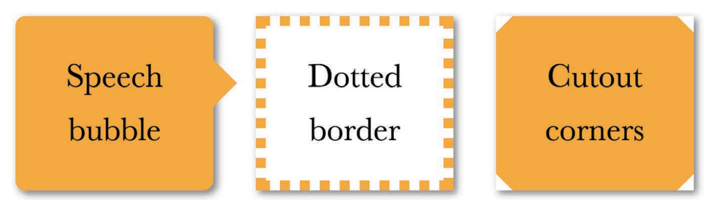

filter 滤镜属性可以解决，将阴影的 css 修改为：

```css
filter: drop-shadow(2px 2px 10px rgba(0, 0, 0, 0.5));
```

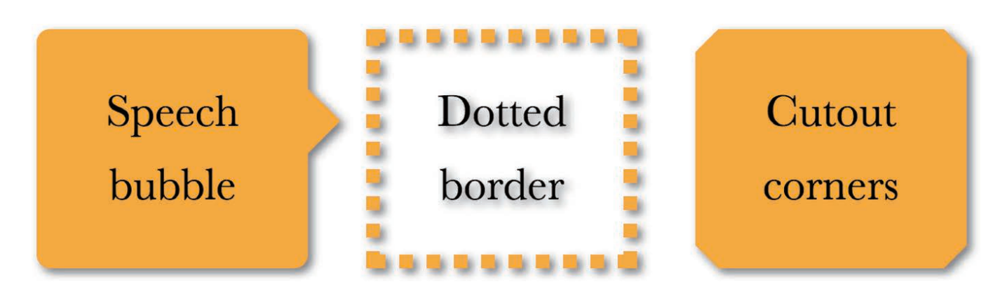

注意：如上图所示，任何非透明的部分都会被一视同仁地打上投影，包括文本（如果背景是透明的），且 text-shadow 跟它是完全不相干，无法通过设置其为 none 解决。

## 5 染色

需求：为一幅灰度图片（或是被转换为灰度模式的彩色图片）增加染色效果（color tint）。除了使用 2 种图片外，还可以在图片的上层覆盖一层半透明的纯色；或者把图片设置为半透明并覆盖在一层实色背景之上。但这其实并不是真正的染色效果：不仅没有把图片中的各种颜色转换为目标色调，同时也极大地削弱了图片的对比度。

此外，把图片置入 `<canvas>` 元素中，并利用脚本对其进行染色处理。这确实可以得到真实的染色效果，但性能不佳，而且限制很多。

### 5.1 滤镜染色

sepia()，它会给图片增加一种降饱和度的橙黄色染色效果，几乎所有像素的色相值会被收敛到 35~40。

如果我们想要的主色调的饱和度比这更高，可以用 saturate() 滤镜来给每个像素提升饱和度。假设我们想要的主色调是 hsl(335, 100%,50%)，那就需要把饱和度提升一些，于是我们将饱和度参数设置为 4。两者结合使用可以达到一种暖金色染色效果。

此外hue-rotate() 滤镜可以把每个像素的色相以指定的度数进行偏移。为了把原有的色相值 40 改变为 335，我们需要增加大约 295 度（335 – 40）：

```css
filter: sepia(1) saturate(4) hue-rotate(295deg);
```

### 5.2 混合方案

当两个元素叠加时，“混合模式”控制了上层元素的颜色与下层颜色进行混合的方式。用它来实现染色效果时，需要用到的混合模式是 luminosity。这种 luminosity 混合模式会保留上层元素的 HSL 亮度信息，并从它的下层吸取色相和饱和度信息。如果在下层准备好我们想要的主色调，并把待处理的图片放在上层并设置为这种混合模式，那本质上也是染色。

要对一个元素设置混合模式的属性有：

- mix-blend-mode 可以为整个元素设置混合模式，需要把图片包裹在一个容器中，并把容器的背景色设置为我们想要的主色调。
- background-blend-mode 可以为每层背景单独指定混合模式，用 div 元素，把这个元素的第一层背景设置为要染色的图片，并把第二层的背景设置为我们想要的主色调。

比如们希望对一个 `` 元素应用这个效果，就需要把它包含在另一个元素内部：

```html
<a href="#something">
  
</a>

<style>
  a {
    background: hsl(335, 100%, 50%);
  }
  img {
    mix-blend-mode: luminosity;
  }
</style>
```

贴士：滤镜是可动画的，而混合模式则不能。一张图片只需要在 filter 属性上设置好 CSS 过渡之后就可以从全彩样式慢慢淡化为单色样式，但直接使用混合模式不行。

mix-blend-mode 是把整个元素向下进行混合，而不管它的下层是什么。因此，如果我们把这个属性设置为 luminosity 混合模式，那图片就总是会跟某些东西进行混合。此外，使用 background-blend-mode 属性则可以让每层背景跟它的下层背景进行混合，但并不关心元素之外是什么情况。另外，当我们只有一个背景图像以及一个透明背景色时，就不会出现任何混合效果！

如下所示，改用 background-blend-mode 实现：

```html
<div class="tinted-image" style="background-image:url(tiger.jpg)"></div>

<style>
  .tinted-image {
    width: 640px;
    height: 440px;
    background-size: cover;
    background-color: hsl(335, 100%, 50%);
    background-blend-mode: luminosity;
    transition: 0.5s background-color;
  }
  .tinted-image:hover {
    background-color: transparent;
  }
</style>
```

上述方案的共同缺点：

- 图片的尺寸需要在 CSS 代码中写死；
- 在语义上，这个元素并不是一张图片，因此并不会被读屏器之类的设备读出来。

## 6 毛玻璃

毛玻璃可以解决文字效果，如下 2 个图对比，有了毛玻璃后文字的显示效果更清晰：
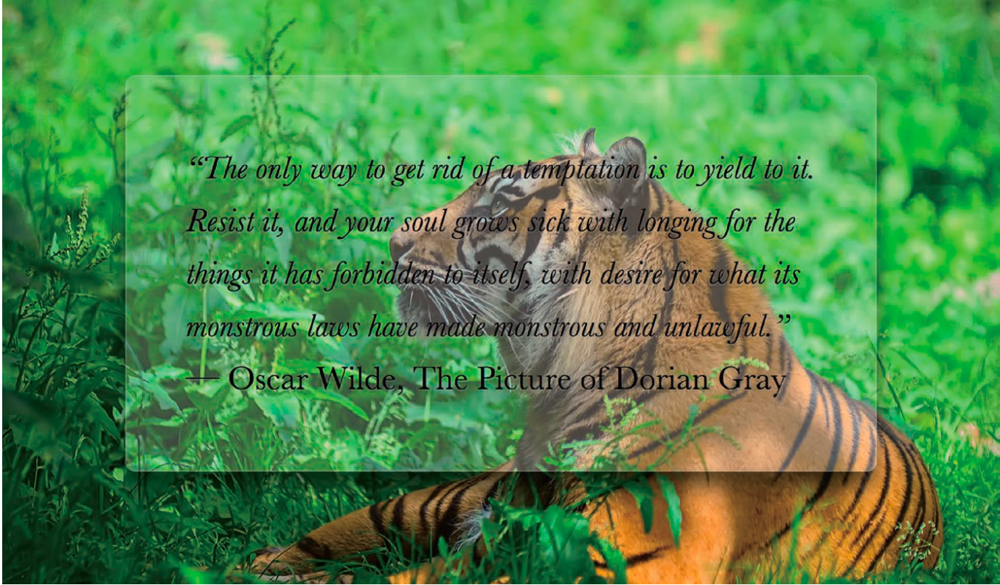
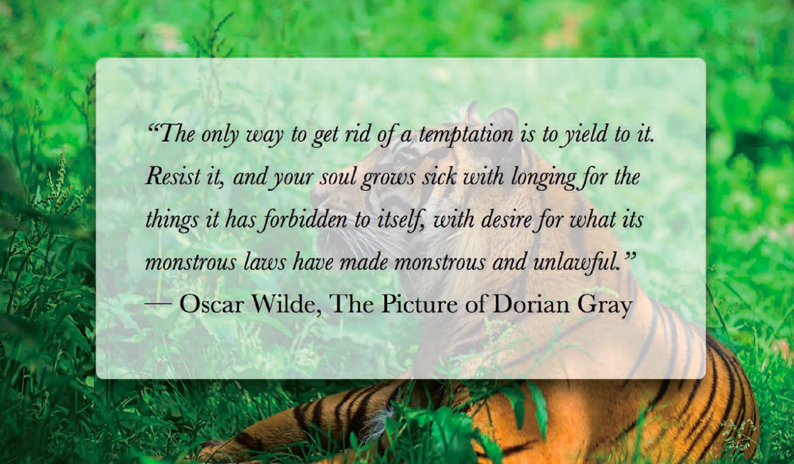

blur() 可以添加毛玻璃效果，但是大背景的 background-attachment 值是 fixed，直接应用该函数有可能导致文字也一起模糊了，此时可以对一个伪元素进行处理，然后将其定位到元素的下层，它的背景将会无缝匹配 body 的背景。

```css
main {
  position: relative;
  /* [其余样式] */
}
main::before {
  content: '';
  position: absolute;
  top: 0;
  right: 0;
  bottom: 0;
  left: 0;
  background: rgba(255, 0, 0, 0.5); /* 仅用于调试，真实环境换成需要的背景即可 */
}
```

贴士：伪元素现在就覆盖在内容元素之上。可以用 z-index: -1; 来修正。

现在换成跟背层完全匹配的背景，要么把 `<body>` 的背景复制过来，要么把伪元素的背景声明合并过去：

```css
body,
main::before {
  background: url('tiger.jpg') 0 / cover fixed;
}
main {
  position: relative;
  background: hsla(0, 0%, 100%, 0.3);
}

main::before {
  content: '';
  position: absolute;
  top: 0;
  right: 0;
  bottom: 0;
  left: 0;
  filter: blur(20px);
}
```

模糊效果在中心区域看起来非常完美，但在接近边缘处会逐渐消退(对伪元素应用一个 red 背景可以清晰看到这个问题)。这是因为模糊效果会削减实色像素所能覆盖的范围，削减的幅度正是模糊半径的长度。

为了补偿这种情况，我们需要让伪元素相对其宿主元素的尺寸再向外扩大至少 20px（即它的模糊半径）。可以通过 -20px 的外边距来达到目的，由于不同浏览器的模糊算法可能存在差异，用一个更大的绝对值（比
如 -30px）会更保险一些。，这个方法可以修复边缘模糊消退的问题，但现在的情况是有一圈模糊效果超出了容器，这让它看起来不像毛玻璃，而更像是玻璃脏了。

办法：只要对 main 元素应用overflow: hidden;，就可以把多余的模糊区域裁切掉了。

```css
body,
main::before {
  background: url('tiger.jpg') 0 / cover fixed;
}
main {
  position: relative;
  background: hsla(0, 0%, 100%, 0.3);
  overflow: hidden;
}
main::before {
  content: '';
  position: absolute;
  top: 0;
  right: 0;
  bottom: 0;
  left: 0;
  filter: blur(20px);
  margin: -30px;
}
```

## 7 折角

折角的纯 CSS 方案原理有：在右上角增加两个三角形：一个三角形用来体现折页的形状，另一个白色的三角形遮住元素的一角，用来模拟翻折所产生的缺口。这两个三角形通常都是由经典的边框技巧来生成的。这种方案也有问题：

- 当折角元素之下的背景不是纯色，而是一幅图案、一层纹理、一张照片、一幅渐变或其他任何一种背景图像时。
- 当我们想要一个 45°以外的（旋转的）折角时。

### 7.1 45°折角的解决方案

在右上角具创建一个 1em 的斜面切角：

```css
background: linear-gradient(-135deg, transparent 2em, #58a 0);
```

增加一个暗色的三角形来实现翻折效果，方法是增加另一层渐变来生成这个三角形并将其定位在右上角，这样就可以通过 background-size 来控制折角的大小：

```css
/* 为了生成这个三角形，我们所需要的就是一个有角度的线性渐变，而这个渐变的两个色标需要在正中央重合： */
background: linear-gradient(
    to left bottom,
    transparent 50%,
    rgba(0, 0, 0, 0.4) 0
  )
  no-repeat 100% 0 / 2em 2em;
```

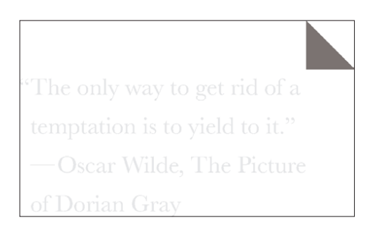

最后把这两层背景组合起来，把折页部分的三角形放在切角渐变之上：

```css
 linear-gradient(to left bottom,
 transparent 50%, rgba(0,0,0,.4) 0)
 no-repeat 100% 0 / 2em 2em,
 linear-gradient(-135deg, transparent 2em, #58a 0);
```

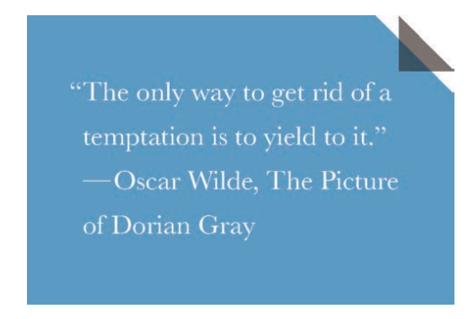

结果并不是我们所期望的那样。原因在于（正如我们在“切角效果”一节中所讨论的那样）第二层渐变中的 2em 折角尺寸是写在色标中的，因此它是沿着渐变轴进行度量的，是对角线尺寸。另一方面，在 background-size 中的 2em 长度是背景贴片的宽度和高度，是在水平和垂直方向上进行度量的。

- 如果要保留对角线的 2em 长度，就要将 background-size 乘以根号 2 。
- 如果要保留水平和垂直方向上的 2em 长度，就要用切角渐变的角标位置值除以根号 2 。

由于 background-size 需要把这个长度重复两次，而且绝大多数的CSS 度量都不是在对角线上进行的，因此第二种方案更加合适。色标的位置值将变成 2 除以根号2，为： 1.414 ，我们可以将其取整为 1.5em：

```css
background:
  linear-gradient(to left bottom, transparent 50%, rgba(0, 0, 0, 0.4) 0)
    no-repeat 100% 0 / 2em 2em,
  linear-gradient(-135deg, transparent 1.5em, #58a 0);
```

### 7.2 其他角度

非 45 度下，比如 -150deg 可以产生 30°的切角

```css
background:
  linear-gradient(to left bottom, transparent 50%, rgba(0, 0, 0, 0.4) 0)
    no-repeat 100% 0 / 2em 2em,
  linear-gradient(-150deg, transparent 1.5em, #58a 0);
```

如果只是改变斜面切角的角度，那么表示翻折部分的三角形并不会跟着改变：

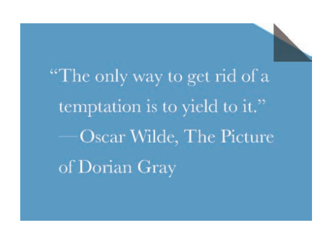

根据直接函数的正弦、余弦函数与勾股定理，计算出三角形实际大小：

```css
background:
  linear-gradient(to left bottom, transparent 50%, rgba(0, 0, 0, 0.4) 0)
    no-repeat 100% 0 / 3em 1.73em,
  linear-gradient(-150deg, transparent 1.5em, #58a 0);
```

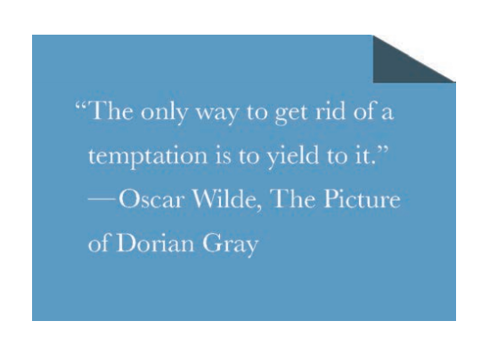

我们会发现这个折页三角形是需要微微旋转的，它的尺寸跟我们从元素角上“切”下来的那个三角形应该是一致的。由于我们无法旋转背景，需要使用伪元素：

```css
.note {
  position: relative;
  background: linear-gradient(-150deg, transparent 1.5em, #58a 0);
}
.note::before {
  content: '';
  position: absolute;
  top: 0;
  right: 0;
  background: linear-gradient(
      to left bottom,
      transparent 50%,
      rgba(0, 0, 0, 0.4) 0
    )
    100% 0 no-repeat;
  width: 3em;
  height: 1.73em;
}
```

接着将把折页三角形的 width 和 height 对调，以此改变它的方向，这样就可以得到跟折页缺口对称的三角形，而不是一个可以补足折页缺口的三角形。然后，我们再以逆时针 30°（(90° – 30° ) –30°）来旋转这个折页三角形，这样可以让它的斜边与折线平行：

```css
.note::before {
  content: '';
  position: absolute;
  top: 0;
  right: 0;
  background: linear-gradient(
      to left bottom,
      transparent 50%,
      rgba(0, 0, 0, 0.4) 0
    )
    100% 0 no-repeat;
  width: 1.73em;
  height: 3em;
  transform: rotate(-30deg);
}
```

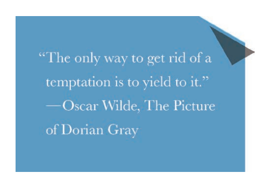

还需要把这个折页三角形再挪动一下，以便让这两个三角形（深色的三角形折页和折角的三角形缺口）的斜边重合。从现在的情况来看，它在水平和垂直方向上都需进行移动，因此要算出这两个偏移量似乎困难重重。我们可以让事情变得更简单一些：把transform-origin 设置为 bottom right，让三角形的右下角成为旋转的中心，这样就可以让它的右下角保持固定。

```css
.note::before {
  /* [其余样式] */
  transform: rotate(-30deg);
  transform-origin: bottom right;
}
```

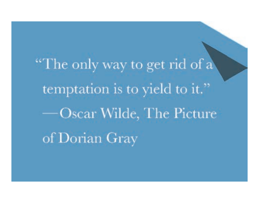

现在只需在垂直方向上向上移动这个折页三角形就可以了：

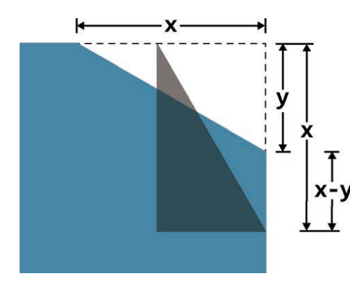

```css
.note::before {
  /* [其余样式] */
  transform: translateY(-1.3em) rotate(-30deg);
  transform-origin: bottom right;
}
```

由于这个折页三角形现在是由伪元素来实现的，我们还可以让它更加真实一些，比如增加圆角、（真正的）渐变以及投影：

```css
.note {
  position: relative;
  background: #58a; /* 回退样式 */
  background: linear-gradient(-150deg, transparent 1.5em, #58a 0);
  border-radius: 0.5em;
}
.note::before {
  content: '';
  position: absolute;
  top: 0;
  right: 0;
  background: linear-gradient(
      to left bottom,
      transparent 50%,
      rgba(0, 0, 0, 0.2) 0,
      rgba(0, 0, 0, 0.4)
    )
    100% 0 no-repeat;
  width: 1.73em;
  height: 3em;
  transform: translateY(-1.3em) rotate(-30deg);
  transform-origin: bottom right;
  border-bottom-left-radius: inherit;
  box-shadow: -0.2em 0.2em 0.3em -0.1em rgba(0, 0, 0, 0.15);
}
```
