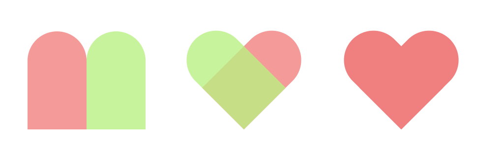

# 选择器

## 1 常见选择器

```css
/* CSS2 */
*                   /* 通配符选择器 */
#div                /* id 选择器 */
.box                /* 类名选择器 */
div                 /* 标签选择器 */
div p               /* 后代选择器：所有后代 */
div.box             /* 交集选择器 */
div,p,span          /* 并集选择器 */

/* CSS3 */
div>p               /* 子代选择器：直接后代 */
div+p               /* 选中 div 后同级第一个 p */
div~p               /* 选中 div 后同级所有 p */
```

## 2 属性选择器

通过属性来选择元素，具体有以下 5 种形式：

```css
/* CSS2 */
E[attr]               /* 属性名=attr 的 div */
E[attr="value"]       /* 属性 attr 值=value 的 div */

/* CSS3 */
E[attr~="value"]      /* 属性值包含 value 字符 */
E[attr*="value"]      /* 属性值包含 value 字符并且在 任意 位置 */
E[attr^="value"]      /* 属性值包含 value 字符并且在 开始 位置 */
E[attr$="value"]      /* 属性值包含 value 字符并且在 结束 位置 */
E[attr|="value"]      /* 属性值是 value 或以 value- 开头的值（比如说 zh-cn） */
```

示例：选择以 icon 开头的

```html
<style>
  div[class=^'icon'] {
    color: red;
  }
</style>
```

## 3 伪类选择器

伪类选择器的作用是为一些元素添加特殊效果，这些效果一般会根据用户的行为而进行动态改变：

```css
E:link {
} /* 超链接默认状态，与 a{}一样 */
E:visited {
} /* 超链接访问过后的样式 */
E:hover {
} /* 鼠标放到超链接上的样式 */
E:active {
} /* 超链接激活状态下的样式 */

E:focus {
} /* 获取焦点的时候的样式 */
```

示例：

```css
/* 链接伪类的书写顺序最好为：lvha */
a:link:hover {
  color: red;
}
```

CSS3 添加了一些新的伪类，如 input 相关，target 伪类，取反伪类。

表单相关伪类（结合锚点进行使用，处于当前锚点的元素会被选中）：

```css
E:required
E:enabled
E:disabled
E:checked

/* 示例，选择 <input type="text" required>*/
input:required {
}
```

`:target` 伪类匹配的元素需要有 id 属性，用来匹配浏览器中的哈希值

```css
/* 网址为：demo.com/#blue 此时选中 .div 的标签中 id="blue" 的元素 */
.div:target {
}
```

`:not` 伪类用来取反：

```js
div:not(.box) {
     background-color: #2aabd2;
}
```

## 4 结构伪类选择器

CSS3 中新增的结构伪类选择器以某元素相对于其父元素或兄弟元素的位置来获取元素。

```css
/* CSS2 */
E:first-child           /* 第一个子元素 */
E:last-child            /* 最后一个子元素 */

/* CSS3 */
E:nth-child(n)          /* E 元素的所有子元素，n 为第几个 */
E:nth-last-child(n)     /* 同 E:nth-child(n) 相似，只是倒着计算 */

E:nth-of-type(n)        /* E 元素的所有子元素中，所在类型的第 n 个元素 */
E:nth-last-of-type(n)   /* 同上，从后向前计算 */

E:empty                 /* 没有任何子节点（包括空格）的 E 元素，(子节点包含文本节点) */
```

注意：

- n 遵循线性变化，其取值是：0、1、2、3、4....。n<=0 时选取无效。
- n 可以是多种形式：`nth-child(2n)`、`nth-child(2n+1)`、`nth-child(-1n+5)`、`nth-last-child(-1n+5)`(后五个) 等；
- n 可以是特殊字符：`even`(偶数)、`odd`(奇数)

示例：

```html
<style>
  div span:nth-of-type(1) {
    background-colr: pink;
  }
</style>

<div>
  <p>第一个</p>
  <span>111</span>
  <span>222</span>
  <span>333</span>
</div>
```

## 5 伪元素选择器

伪元素选择器用于在选中元素的前、后插入一个行内元素！！该选择器用于不想给页面添加 HTML 标记的场景，示例：

```html
<style>
  div::before {
    content: '你';
  }
</style>

<div>好</div>
```

在上述示例中，浏览器会显示："你好"。伪元素出现的本意是给文本前、后添加内容，所以存在文本属性 content，这个属性是必须要写的，哪怕是空字符串。

### 5.1 案例：使用伪元素拼接多色圆环

```html
<div class="circle"></div>

<style>
  .circle,
  .circle::before,
  .circle::after {
    width: 10em;
    height: 10em;
    box-sizing: border-box;
    border-top: 0.3em solid;
    border-radius: 50%;
  }

  .circle {
    position: relative;
    border-top-color: red;
  }

  .circle::before,
  .circle::after {
    content: '';
    position: absolute;
    top: -0.2em;
  }

  /* 重要：让 2 个伪元素旋转，合并为一个圆环 */
  .circle::before {
    border-color: green;
    transform: rotate(120deg);
  }
  .circle::after {
    border-color: gold;
    transform: rotate(240deg);
  }
</style>
```

不过现代 css 还有更好的做圆环的色彩控制：

```css
.circle {
  width: 10em;
  height: 10em;
  border-radius: 50%;
  background: conic-gradient(
    red 0deg 120deg,
    green 120deg 240deg,
    gold 240deg 360deg
  );
  /* 如果要做成空心圆环，加一个 mask */
  mask: radial-gradient(transparent 65%, black 66%);
  -webkit-mask: radial-gradient(transparent 65%, black 66%);
}
```

### 5.2 案例：用伪元素制作一个心形图案



从图中看出，心形的本质是 2 个大小相等的拱形：

```html
<figure class="heart"></figure>
<figure class="heart"></figure>
<figure class="heart"></figure>

<style>
  .heart {
    font-size: 10px;
    width: 12em;
    position: relative;
    margin: 0 2em;
    display: flex;
  }

  .heart::before,
  .heart::after {
    content: '';
    position: relative;
    width: 6em;
    height: 10em;
    border-radius: 3em 3em 0 0;
  }

  .heart:nth-child(1)::before {
    background-color: hsl(0, 79%, 72%, 0.8);
  }
  .heart:nth-child(1)::after {
    background-color: hsl(90, 79%, 72%, 0.8);
  }

  .heart:nth-child(2)::before {
    background-color: hsl(0, 79%, 72%, 0.8);
  }
  .heart:nth-child(2)::after {
    background-color: hsl(90, 79%, 72%, 0.8);
  }

  .heart:nth-child(2)::before {
    transform-origin: right bottom;
    transform: rotate(45deg);
  }

  .heart:nth-child(2)::after {
    transform-origin: left bottom;
    transform: rotate(-45deg);
  }

  .heart:nth-child(3)::before {
    background-color: lightcoral;
    transform-origin: right bottom;
    transform: rotate(45deg);
  }

  .heart:nth-child(3)::after {
    background-color: lightcoral;
    transform-origin: left bottom;
    transform: rotate(-45deg);
  }
</style>
```
