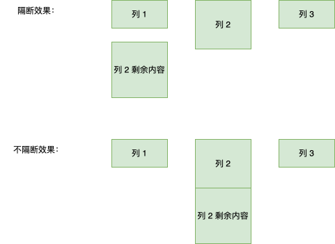

# 分栏布局

## 1 分栏布局概念

分栏布局也即：多列布局，将多个相同平级子元素在内的内容拆分为列显示。

## 2 columns属性使用

columns 属性可以实现分栏布局，如下所示：

```css
// 分为 2 列
ul {
  columns: 2;
}
```

grid 和 flex 布局也可以实现分栏效果，但是 li 元素会丢失项目符号。

贴士：分栏布局一般学会columns、column-width、column-count、gap 属性即实现大多场景需求。

### 2.1 column-width、column-count 分栏数量

columns属性是column-width和column-count属性的缩写，常用值有：

```css
/* 栏目宽度 */
columns: 18em;
/* 栏目数目 */
columns: auto;
columns: 2;
/* 同时定义宽度和数目，顺序任意 */
columns: 2 auto;
columns: auto 2;
columns: auto 12em;
columns: auto auto;
```

注意：分栏布局会无视容器宽度，如果容器宽度 width 为 300px，而分栏宽度是 200px，分为两栏明显会超出容器宽度，则浏览器会无视 `column-width:200px`，按照容器宽度 300px 排版。这是因为
`column-width` 属性是一个期望值，浏览器根据该值确定分栏数，一旦确定后，这个值就失去了意义，不会对实际分栏效果产生影响，所以这个属性值也不支持 百分比写法。

若 `column-width` 和 ``column-count` 同时存在（后者表示期望分栏数量），则哪个值小用哪一个。

### 2.2 gap、column-gap 分栏间隙

gap 属性表示每一栏之间的空白间隙的大小，可以是长度值，也可以是百分比值，column-gap 是 gap 的子属性，可以兼容 IE 的。

贴士：行、列间的间隙在 CSS 中统一用 gap 表示，gap 本身则是column-gap属性和row-gap属性的缩写。

### 2.3 column-rule 分栏分割线样式

column-rule 用来设置分栏分割线的样式。

column-rule 是column-rule-width、column-rule-style、column-rule- color缩写，与 border 语法一致。

### 2.4 column-span 内容跨栏

column-span 用来设置某个内容是否可以跨多栏显示，类似 表格中的 colspan：

```css
column-span: none;  // 默认值 示不横跨多栏
column-span: all;   // 横跨所有垂直列
```

贴士：比如在分栏布局中突然要插入一行广告，则广告所在行可以横跨所有列即可实现。

### 2.5 column-fill 内容填充

```css
column-fill: balance;       // 默认值 尽可能在列之间平衡内容，。在分隔断开的上下文中，只有最后一个片段是平衡的。有可能导致最后一栏内容较少
column-fill: auto;          //按顺序填充每一列，内容值占用其所需要的空间
column-fill: balance-all;   // 无浏览器支持！
```

## 3 分栏布局作用

### 3.1 实现单行两端对齐

分栏布局非常适合实现单行的两端对齐布局效果：

```html
<style>
  .container {
    width: 300px;
    border: solid deepskyblue;
    column-count: 3;
    column-gap: 5%;
  }
  .list {
    height: 100px;
    background-color: deeppink;
  }
</style>
<div class="container">
  <div class="list"></div>
  <div class="list"></div>
  <div class="list"></div>
</div>
```

贴士：column-gap只能实现单行内容的两端对齐效果。

### 3.2 实现电子书水平翻阅

电子书的水平翻阅效果可以使用分栏布局实现：所有文字按照屏幕的高宽分栏，每一栏是一页，因为屏幕只有这么大，所以用户每次最多只会看到一页内容，只要容器元素每次移动屏幕同等的宽度，就有了水
平翻阅的效果。

## 4 特殊效果

### 4.1 break-inside 防止内容断开

break-inside属性可以定义页面打印、分栏布局发生中断时元素的表现形式：

```css
break-inside: auto; // 表示元素可以中断。
break-inside: avoid; // 表示元素不可以中断。
```

分栏布局中，如果一些元素未按照预期效果流动，有时候一个元素会断开为 2 部分显示，分布到了 2 个列中（比如一个过高的列不足以显示全，会被截断到第二行的一个列中显示），可以使用该属性的 avoid 值控制住（会产生瀑布流效果，多列中一个列特别高）。



### 4.2 box-decoration-break 防止样式隔断

在默认情况下，元素片段在跨行、跨列或跨页（如打印）时候的样式是分割渲染的，例如边框或者圆角都是分割开的。如果希望因为分栏断开的文字在每一栏中都拥有独立完整的边
框，则可以使用box-decoration-break属性实现。

```css
box-decoration-break: slice; // 默认值 示各个元素断开的部分如同被切开一般。
box-decoration-break: clone;// 断开的各个元素的样式独自渲染
```

示例：

```css
。
  下面来看一下box-decoration-break:clone声明对分栏布
  局样式的影响，CSS代码如下：
  .container {
  width: 300px;
  columns: 2;
}
// 这时候每个列都会独立渲染边框。如果不设置，则边框会被隔断
.container p {
  border: solid deepskyblue;
  -webkit-box-decoration-break: clone;
  box-decoration-break: clone;
}
```

贴士：box-decoration-break 属性只能影响这些属性效果：background、border、border-image、box-shadow、border-radius、clip-path、margin、padding。
