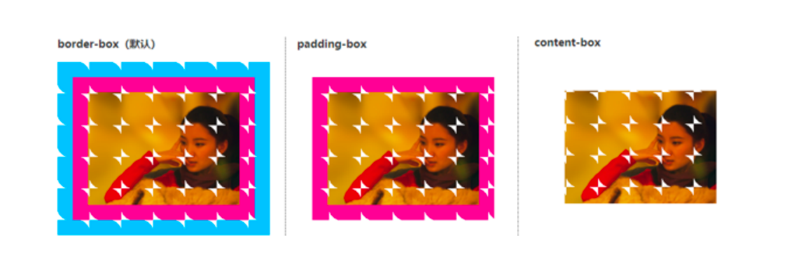
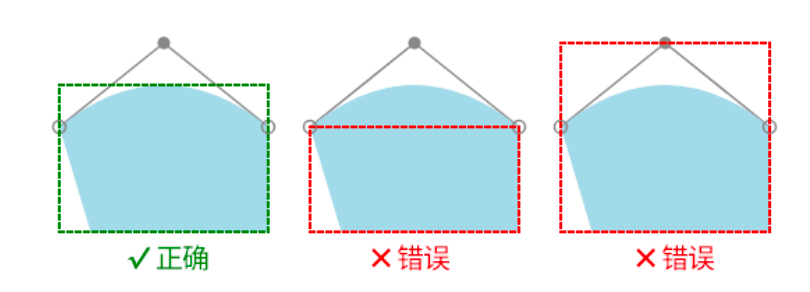

#

遮罩：只会显示遮罩图像，而非内部透明区域的内容。

```css
img {
  mask: no-repeat center / contain;
  mask-image: url(demo1.png);
}
```

显示 demo1.png 而不是显示 img src 属性值。SVG 也可以作为遮罩层，此时默认会按照当前匹配元素的尺寸进行等比例缩放。若果其中包含 `<mask>` 遮罩元素，也可以作为mask-image属性的合法属性值。

常见属性有：mask-image、mask-repeat、mask-position、mask-origin、mask-size等，与 background 的用法一致。

## mask-image

mask-image：

- none是默认值，表示默认无遮罩图片。
- `<image>` 表示图像数据类型，包括CSS渐变图像、url()函数、image-set()函数、cross-fade()函数和element()函数
- `<mask-source>` 表示遮罩元素类型，主要指SVG遮罩元素

一般情况下，遮罩都是使用用渐变图像实现的：

```css
img {
  width: 256px;
  height: 192px;
  mask-image: radial-gradient(
      600px 80px at top,
      transparent 150px,
      black 152px 1000px,
      transparent 0
    )
    ，
    radial-gradient(
      600px 80px at bottom,
      transparent 150px,
      black 152px 1000px,
      transparent 0
    );
}
```

## mask-clip

mask-clip属性用来设置遮罩效果显示的盒子区域。

```txt
mask-clip: border-box;
mask-clip: padding-box;
mask-clip: content-box;
mask-clip: no-clip;
mask-clip: fill-box;
mask-clip: stroke-box;
mask-clip: view-box;
```

Chrome 仅支持是border-box、padding-box和content-box。



no-clip作用是不对元素的遮罩效果做区域上的限制，例如，轮廓（outline）、盒阴影（box-shadow）都是可以应用遮罩效果的。

fill-box、stroke-box和view-box这3个关键字属性值要应用在SVG元素上才有效果：

- fill-box表示遮罩应用的区域是图形填充区域形成的边界盒子
- stroke-box表示的遮罩区域把描边占据的区域也包含在内
- view-box表示使用最近的SVG视口作为参考盒子。如果SVG代码中的viewBox属性有设置，则遮罩区域盒子位于viewBox属性建立的坐标系的原点，尺寸由viewBox属性中的宽高值决定。



## mask-mode/mask-type

mask-mode属性的默认值是match-source，作用是根据资源的类型自动采用合适的遮罩模式，该属性在 Chrome 上支持度不佳。

如果遮罩效果使用的是SVG中的 `<mask>` 元素，则此时的mask-mode属性的计算值是luminance，表示基于亮度判断是否要进行遮罩。如果是其他场景，则计算值是alpha，表示基于透明度判断是否要进行遮罩。

mask-mode:

- mask-mode: match-source;
- mask-mode: luminance;
- mask-mode: alpha;

mask-image支持多图片，因此mask-mode也支持多属性值：`mask-mode: alpha, match-source;`。

mask-type属性的功能和mask-mode属性类似，都是设置不同的遮罩模式，但还mask-type属性只能作用在SVG元素上，此默认值表现为SVG元素默认遮罩模式，也就是默认值是luminance亮度遮罩模式。如果需要支持透明度遮罩模式:

```css
mask-type: alpha;
```

## mask-composite

mask-composite表示同时使用多张图片进行遮罩时的合成方式：

```css
/* add 默认值表示遮罩累加 */
mask-composite: add;
/* 遮罩相减，也就是遮罩图片重合的区域不显示。这就意味着，遮罩图片越多，遮罩区域越小。 */
mask-composite: subtract;
/* intersect表示遮罩相交，也就是遮罩图片重合的区域才显示遮罩 */
mask-composite: intersect;
/* exclude表示遮罩排除，也就是遮罩图片重合的区域被当作透明的 */
mask-composite: exclude;
```

假设有两个遮罩图像：

```css
mask-image: circle.svg, rect.svg;
```

代码中顺序越往后的图像层级越低，因此，rect.svg的位置在circle.svg的下方。在W3C的合成和混合规范中，处在上方的元素称为“source”，表示资源元素；处在下方的元素称为“destination”，表示目标元素。这里，circle.svg就是“source”，rect.svg则是“destination”。

- mask-composite: add表现为“source over”，即circle.svg覆盖在rect.svg的上方，两者共同组成最终的遮罩图像
- mask-composite: subtract表现为“source out”，也就是扣除上面的circle.svg覆盖的区域，最终表现为circle.svg和rect.svg重叠的区域消失，
- mask-composite: intersect表现为“source in”，也就是circle.svg和rect.svg重叠的部分作为遮罩区域
- mask-composite: exclude表现为“xor”，也就是最终合成的遮罩区域是非重叠的部分

属性值exclude经常用于渐变图像，可以实现反向遮罩效果，是比较实用的一个属性值。exclude属性值最常见的应用是实现镂空的遮罩效果：

```html
<style>
  .mask-image {
    mask:
      url(../images/bird.png) no-repeat center / contain,
      linear-gradient(black, black);
    -webkit-mask-composite: xor;
    mask-composite: exclude;
  }
</style>

```

一些属性值含义：

- source-over表示遮罩区域累加，效果和CSS规范中的add值是一样的。
- source-in表示遮罩区域是交叉重叠的区域，效果和CSS规范中的intersect值是一样的。
- source-out表示遮罩区域是上层图像减去其和下层图像重叠的区域，效果和CSS规范中的subtract值是一样的。
- source-atop表示保留底层图像区域，并在其上方累加上层和下层图像重叠的区域。destination-over表示下层遮罩图像叠加在上层遮罩图像上。不过，由于默认的遮罩模式是基于alpha通道计算的，也就
  是基于透明度计算的，因此source-over和destination￾over效果都是一样的，除非遮罩模式是基于亮度计算的，两者才会有明显的区别。`destination-*` 这几个值和上面 `source-*` 几个属性值的区别就是，`source-*`是上层图像对下层图像如何，而 `destination-*` 是下层图像对上层图像如何(上下层图像的位置调换了)
- destination-in表示遮罩区域是交叉重叠的区域。
- destination-out表示遮罩区域是下层图像减去其和上层图像重叠的区域。
- destination-atop表示保留上层图像区域，并在上方累加上层和下层图像重叠的区域。
- xor表示上层图像和下层图像重叠的区域透明，效果和CSS规范中的exclude属性值是一样的。
- copy表示忽略下层图像，只使用上层图像区域作为遮罩区域。

## 遮罩的经典案例

PNG/SVG背景图标变色最佳实践:

```css
.icon-delete {
  display: inline-block;
  width: 20px;
  height: 20px;
  /* 背景色设为当前color的颜色 */
  background-color: currentColor;
  /* 小图标图像作为遮罩图像使用 */
  --mask: url(delete.png) no-repeat center / 1.125em 1.125em;
  -webkit-mask: var(--mask);
  mask: var(--mask);
}
```

大尺寸PNG图片的尺寸优化：
PNG格式图片的尺寸和图片的色彩丰富度是正相关的，色彩越丰富，文件的尺寸越大，对 PNG 压缩则会失真，转换为 JPG 可以减少大小，但是又无法要保留背景透明的特性。利用遮罩，是只显示遮罩图像的非透明区域，因此只需要准备一张边角透明的任意颜色的遮罩图像，就可以让JPG图片边角的白色区域变透明，步骤如下：

- 把PNG图片保存为JPG图片，以见效图片体积
- 根据PNG图片的轮廓制作纯色PNG图片，并将纯色PNG图片命名为leaf-mask.png，纯色 PNG 图片就小了
- 使用CSS遮罩让JPG图片边角的白色区域透明

```css
img {
  -webkit-mask-image: url(leaf-mask.png);
  mask-image: url(leaf-mask.png); // 还可以转换为 Base64
}
```
