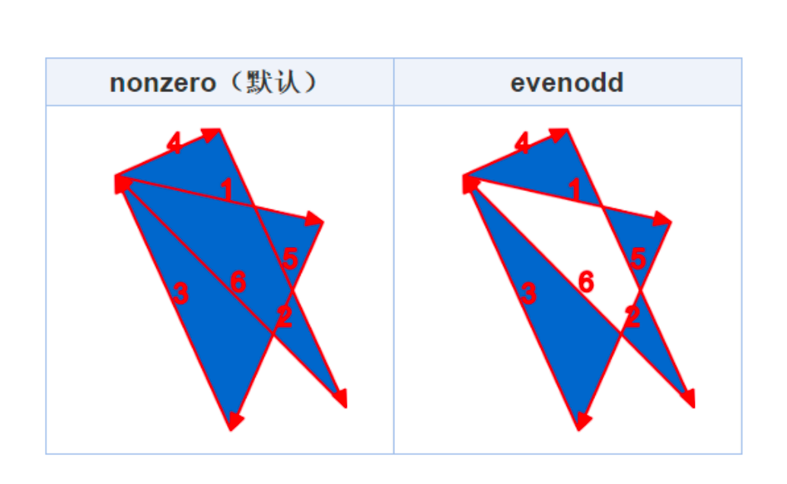
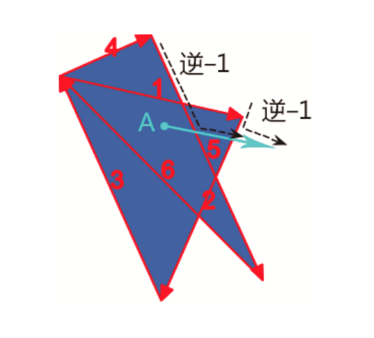
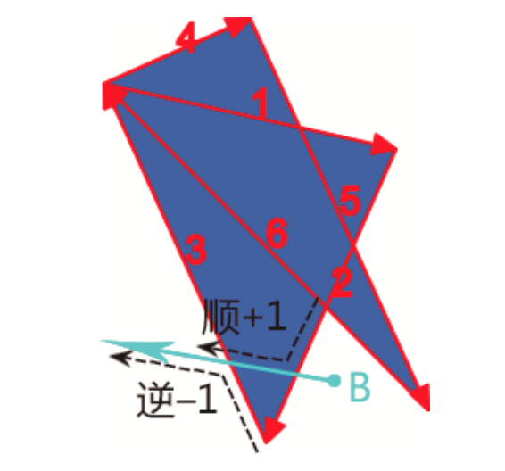
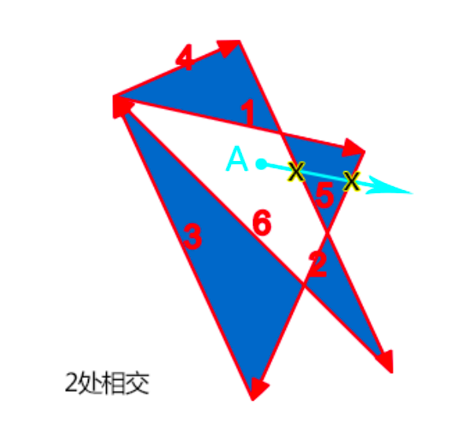
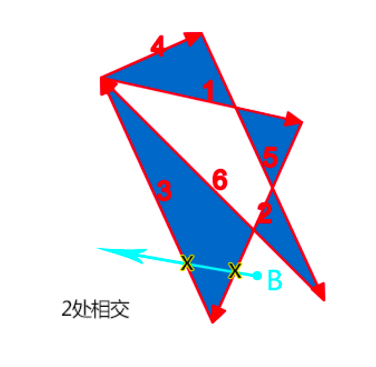
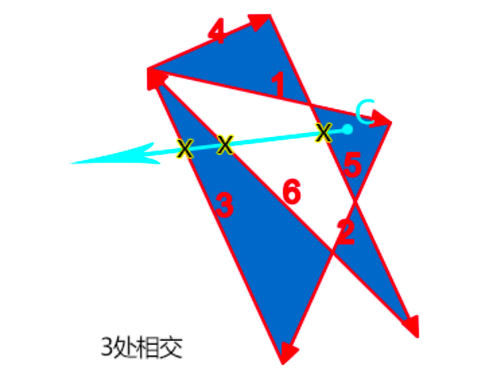

# 剪裁/滤镜

clip-path 属性用于在元素内创建一个剪切区域，区域外部分将被隐藏，仅先是区域内部分，其提供的函数可以用来绘制各种图形：

- inset()：矩形
- circle()：圆形
- ellipse()：椭圆
- polygon()：多边形

滤镜函数可以修改颜色、模糊度、亮度等视觉效果：

- opacity()：透明度
- blur()：模糊
- hue-rotate()：色相。将色相环旋转多少度
- brightness()：亮度
- contrast()：对比度
- lter()：多重滤镜

色彩混合：颜色混合模式 mix-blend-mode 用于将 2 个图层的颜色融合在一起，共有 16 种混合模式。

- multiply模式：类似染料重叠
- screen模式：类似多束光投影到屏幕上，如：舞台的灯光混合效果
- difference模式：一个图层的白色部分会合成为另一个图层的反色，黑色部分保留另一个图层本身的颜色。
- color-didge：一个图层的白色部分会加亮另一个图层，黑色部分合成为另一个图层本身的颜色

## 填充规则

clip-path 属性的polygon()函数支持一个名为`<fill-rule>`的数据类型，表示填充规则。在填充规则中，图形的内部、外部由复杂路径构成，内部则填充，外部则透明：

- nonzero：计算顺时针和逆时针数量是否为 0，非 0 表示内部，表现为填充，为 0 则表示外部，则不填充
- evenodd：计算交叉路径数量是否为奇数，如果是奇数则表示内部，表现为填充；如果是偶数则表示外部，表现为不填充。



要判断某一个区域在路径内部还是路径外部，只需要在这个区域内任意找一个点，然后以这个点为起点，发射一条无限长的射线。

### nonzero规则

nonzero规则：起始值为0，射线会和路径相交，如果路径方向和射线方向形成的是顺时针方向则值加1，如果是逆时针方向则值减1，如果最后数值为0，则是路径的外部；如果数值不是0，则是路径的内部。

如图所示：A点随便发出一条射线，结果经过了路径5和路径2。我们顺着路径前进方向和射线前进方向，可以看到合并后的运动方向都是逆时针，因此最后计算值是−2，不是0。所得结果表示A点处于内部，可以被填充：



下图中，B点发出一条射线，会经过两条路径，分别是路径2和路径3，我们顺着路径前进方向和射线前进方向可以看到，合并后的运动方向一个是逆时针，一个是顺时针，因此，最后的计算值是0。所得结果表示B点处于外部，不被填充：



### evenodd规则

evenodd规则：起始值为0，射线会和路径相交，每交叉一条路径，值就加1，最后看总计算数值，如果是奇数，则认为是路径内部；如果是偶数，则认为是路径外部。

的A点随便发出一条射线，射线经过了路径5和路径2，交叉的路径个数为2，是偶数，因此A点所在区域属于路径外部，不填充：



下图B点发出一条射线，经过路径2和路径3，交叉的路径个数为2，是偶数，因此B点所在区域属于路径外部，不填充：



下图C点，其发出的射线总共和3个路径交叉，是奇数，因此C点所在区域属于路径内部，要填充：



## 裁剪应用

### 实现元素显示与隐藏

和 transform 类似，clip-path属性在应用剪裁效果的时候元素原始的位置完全保留，不用担心会影响布局。所有clip-path基本图形函数都可以实现动画效果。例如，元素以圆形的
方式慢慢呈现，或者以多边形的方式呈现等。

部分效果见张新旭老师的网站：<https://demo.cssworld.cn/new/12/2-6.php>

渐变提示框：

```css
ui-tips {
  display: inline-block;
  max-width: 250px;
  padding: 10px 15px 26px;
  color: #fff;
  position: relative;
  z-index: 0;
}
ui-tips::before,
ui-tips::after {
  content: '';
  background: linear-gradient(45deg, deepskyblue, deeppink);
  position: absolute;
  left: 0;
  right: 0;
  top: 0;
  bottom: 0;
  z-index: -1;
} /*
剪裁圆角矩形 */
ui-tips::before {
  clip-path: inset(0% 0% 16px round 6px);
} /*
剪裁三角形矩形 */
ui-tips::after {
  clip-path: polygon(
    calc(2em + 18px) calc(100% - 16px),
    calc(2em + 9px) calc(100% - 6px),
    2em calc(100% - 16px)
  );
}
```

## 示例

### 荷花

```html
<figure class="lotus">
  <div></div>
  <div></div>
  <div></div>
  <div></div>
  <div></div>
  <div></div>
  <div></div>
  <div></div>
  <div></div>
  <div></div>
</figure>

<style>
  body {
    margin: 0;
    height: 100vh;
    display: flex;
    align-items: center;
    justify-content: center;
    background-color: lightyellow;
  }

  .lotus {
    width: 20em;
    height: 11.5em;
    position: relative;
  }

  .lotus div {
    position: absolute;
    box-sizing: border-box;
    width: 10em;
    height: 3em;
    border: 0.2em solid dimgray;
    border-radius: 50%;
    background-color: hsl(60, 100%, 50%);
    transform-origin: right;
    top: calc((20em - 3em) / 2);
    box-shadow: 0 0 1em hsla(0, 0%, 0%, 0.5);
  }

  .lotus div:nth-child(2) {
    transform: rotate(20deg);
  }
  .lotus div:nth-child(3) {
    transform: rotate(40deg);
  }
  .lotus div:nth-child(4) {
    transform: rotate(60deg);
  }
  .lotus div:nth-child(5) {
    transform: rotate(80deg);
  }
  .lotus div:nth-child(6) {
    transform: rotate(100deg);
  }
  .lotus div:nth-child(7) {
    transform: rotate(120deg);
  }
  .lotus div:nth-child(8) {
    transform: rotate(140deg);
  }
  .lotus div:nth-child(9) {
    transform: rotate(160deg);
  }
  .lotus div:nth-child(10) {
    transform: rotate(180deg);
  }

  .lotus div:nth-child(2) {
    filter: hue-rotate(30deg);
  }
  .lotus div:nth-child(3) {
    filter: hue-rotate(60deg);
  }
  .lotus div:nth-child(4) {
    filter: hue-rotate(90deg);
  }
  .lotus div:nth-child(5) {
    filter: hue-rotate(120deg);
  }
  .lotus div:nth-child(6) {
    filter: hue-rotate(150deg);
  }
  .lotus div:nth-child(7) {
    filter: hue-rotate(180deg);
  }
  .lotus div:nth-child(8) {
    filter: hue-rotate(210deg);
  }
  .lotus div:nth-child(9) {
    filter: hue-rotate(240deg);
  }
  .lotus div:nth-child(10) {
    filter: hue-rotate(270deg);
  }
</style>
```

### 彭罗斯三角形

```html
<figure class="penrose">
  <div></div>
  <div></div>
  <div></div>
</figure>

<style>
  body {
    margin: 0;
    height: 100vh;
    display: flex;
    align-items: center;
    justify-content: center;
  }

  .penrose {
    width: 20em;
    height: 20em;
    position: relative;
    top: -1em;
    left: -3em;
  }

  .penrose div {
    position: absolute;
    width: inherit;
    height: inherit;
    background-color: limegreen;
    clip-path: polygon(57% 0, 75% 0, 26% 85%, 89.5% 85%, 98.4% 100%, 0 100%);
  }

  .penrose div:nth-child(2) {
    transform: rotate(120deg);
  }
  .penrose div:nth-child(3) {
    transform: rotate(240deg);
  }

  .penrose div:nth-child(2) {
    filter: brightness(0.66);
  }
  .penrose div:nth-child(3) {
    filter: brightness(0.33);
  }

  .penrose div:nth-child(2) {
    top: 18.3%;
    left: 43.3%;
  }

  .penrose div:nth-child(3) {
    top: 46.5%;
    left: 5.9%;
  }
</style>
```
