# 混合模式

##

混合是指不同的的色值交叉出现后产生的新颜色，根据不同的混合模式产生不同的值。

CSS混合模式相关属性：

- background-blend-mode属性用于混合元素背景图案、渐变和颜色；
- mix-blend-mode属性用于元素与元素之间的混合；
- isolation属性用在祖先元素上，限制mix-blend-mode属性设置的混合模式的应用范围。

支持的属性值：

```tx
normal 正常
multiply 正片叠底
screen 滤色
overlay 叠加
darken 变暗
lighten 变亮
color-dodge 颜色变淡
color-burn 颜色加深
hard-light 强光
soft-light 柔光
difference 差值
exclusion 排除
hue 色调
saturation 饱和度
color 颜色
luminosity 亮度
```

混合模式可以是用在图片、视频等元素中，实现多媒体中添加

## 1 mix-blend-mode:multiply

mix-blend-mode:multiply 称呼正片叠底，任意颜色和黑色（色值是0）正片叠底后一定是黑色，任意颜色和白色（色值是255）正片叠底后一定是当前颜色。由于和 的RGB色值最大就是255，因此，除和黑、白两色混合时颜色不变之外，和其他颜色混合的正片叠底效果一定是会变暗的。也就是说，正片叠底可以增强两张图像中暗的部分，其表现就像两张半透明相片叠在一起放在发光的桌子上，因此称为“正片叠底”。

混合 2 种色值后最终色值算法是：

$$
C = \frac{AB}{255}
$$

例如：颜色关键字deepskyblue的RGB色值是rgb(0,192,255)，颜色关键字deeppink的RGB色值是rgb(255,20,147)，二者混合后的色值是：是rgb(0,15,147)。计算过程是：

$R = 0 \times 255 \div 255 = 0$
$G = 192 \times 20 \div 255 \approx 15$
$B =255 \times 147 \div 255 = 147$

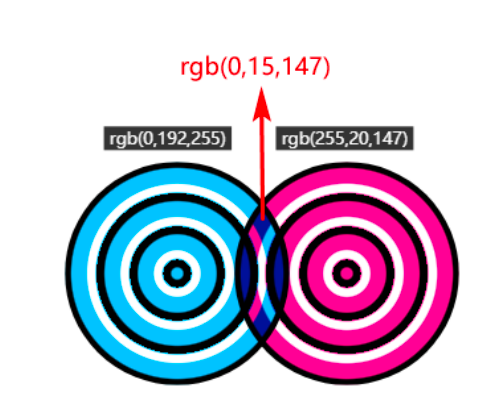

在Web开发中，正片叠底主要用来将浅色的素材进行背景合成。

原图：


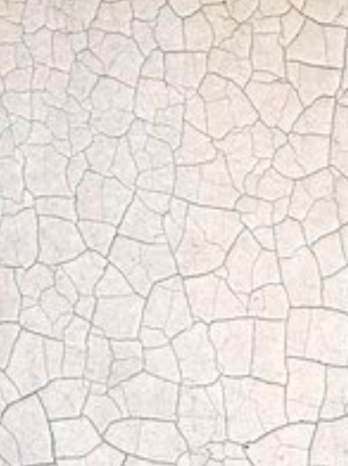

混合效果：

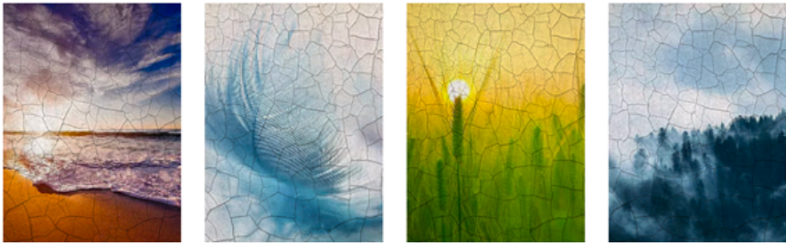

## 2 mix-blend-mode:screen

mix-blend-mode:screen 的混合效果是滤色模式，具有以下一些直观的特性：

- 任何颜色和黑色进行滤色混合后，还是呈现原来的颜色；
- 任何颜色和白色进行滤色混合后得到的仍是白色；
- 任何颜色和其他颜色进行滤色混合后，颜色会更浅，有点类似漂白的效果

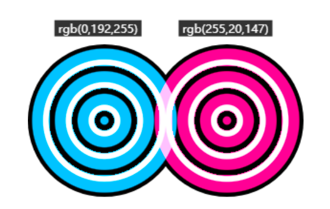

最终效果的色值的计算公式是：

$$
C = 255 - \frac{(255 - A)(255 - B)}{255}
$$

滤色模式非常适合用于在图像中创建霓虹辉光效果。比如 Web 开发中，各种天气效果或者霓虹辉光效果等。传统做法是使用一张透明的PNG图像作为前景图，但是使用PNG透明前景图有下面两个缺点：

- 效果不自然，缺少与底图完全融为一体的感觉
- 图片文件实在是太大了，动不动就上百KB

有了滤色模式，只需要要准备一张底色为黑色的JPG图像就可以了。JPG图像和底图的融合效果更好（因为使用滤色混合模式的时候，黑色会被视为透明），且由于是JPG格式，图像文件大小只有PNG图像的1/10。

原图：
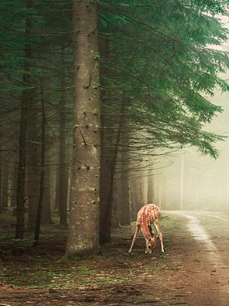

底图：
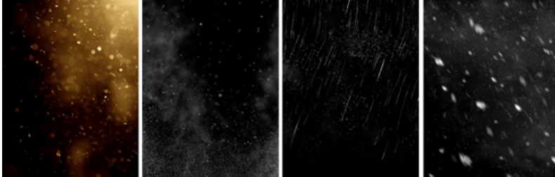

混合后效果：
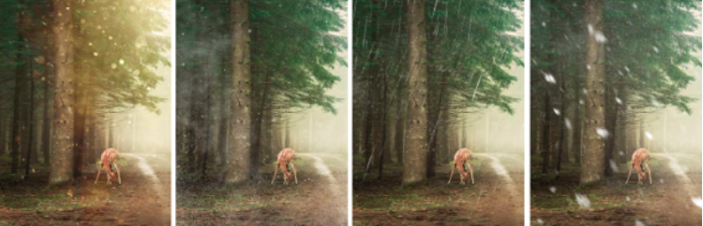

## 3 mix-blend-mode:overlay

值overlay的混合效果是叠加：

\[
C = \begin{cases}
\dfrac{AB}{128}, & A \leq 128 \\[10pt]
255 - \dfrac{(255 - A)(255 - B)}{128}, & A > 128
\end{cases}
\]

在底图色值小于或等于128的时候，采用了类似“正片叠底”的算法，而底图色值大于128的时候，采用了类似“滤色”的算法，因此，叠加这种混合模式的底图的高光（白色）和阴影（黑色）的颜色会被保留，其他颜色的饱和度和对比度会有一定的提高，混合后的图像看起来会更鲜亮。

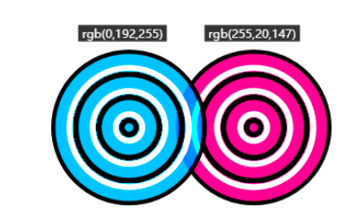

叠加效果在Web中主要有两个应用场景，一个是在图像上显示文字水印，另一个是着色叠加。比如实现水印：使用深色文字，将混合模式设置为叠加，再将文字旋转一定角度：

```html
<style>
  .water {
    width: 256px;
    height: 192px;
    position: relative;
  }
  .water::before {
    content: 'cssworld.cn';
    position: absolute;
    mix-blend-mode: overlay;
    text-shadow:
      10ch 2em,
      -10ch 2em,
      10ch -2em,
      -10ch -2em,
      0 -5em,
      0 5em;
    transform: rotate(-30deg);
    left: calc(50% - 5ch);
    top: 90px;
  }
</style>
<div class="water">
  
</div>
```

着色叠加适合给浅色的文字内容赋色，可以通过将一个带背景色的矩形方块覆盖在文字上来实现。例如，一段文本要实现搜索关键词高亮显示的效果，我们无须将匹配的文本用一个专门的标签包裹起来进行颜色设置，因为这会改动HTML的DOM结构，可以直接使用色块覆盖文字，然后设置混合模式为叠加：

```css
/* 在不改变DOM结构的情况下改变特定区域的文字的颜色 */
div {
  position: absolute;
  background: red;
  mix-blend-mode: overlay;
  z-index: 9;
}
```

## 4 mix-blend-mode:darken/light

darken表示将两种颜色的RGB通道值依次进行比较，哪个色值小就使用哪个色值，最终达到变暗效果。

\[
C = \min(A, B)
\]

light表示将两个颜色的RGB通道值依次进行比较，哪个色值大就使用哪个色值，最终的阿道变亮效果：
\[
C = \max(A, B)
\]

在 web 中，可以用来实现任意PNG图标的变色效果，比mask遮罩属性的变色效果更自由；可以实现任意文字的填充效果，比background-clip:text声明实现的效果更丰富；也可以实现任意不规则形状的剪裁效果，比clip-path属性更灵活。所有这些效果的实现，只需要图标、文字或者形状是纯黑色即可。

文字变亮效果：

```css
// 设置文字为黑色，在文字上覆盖一层渐变颜色，设置混合模式为lighten。
// 因为任何颜色和黑色进行变亮混合后都会保留当前的颜色
<style>
.gradient-text {
    position: relative;
    font-size: 3rem;
    /* 文字颜色设为黑色 */
    color: black;
    /* 背景颜色设为白色 */
    background: #fff;
}
.gradient-text::before {
    content: "";
    position: absolute;
    left: 0; right: 0; top: 0; bottom: 0;
    background: linear-gradient(to right, deepskyblue, deeppink);
    /* 混合模式设为lighten */
    mix-blend-mode: lighten;
}
</style>
<div class="gradient-text">Test</div>
```

使用混合模式时，进行混合的可以是任意元素，且这些元素可以随意进行变换或设置动画效果，而 background-clip:text声明实现的文字渐变效果本质上是使用背景图填充文字，所以使用变亮混合模式实现的文字填充效果可以制作更丰富的效果：

```css
// 使用条纹背景进行混合，同时让条纹背景不断旋转，实现纹理不断变化的文字填充
<style>
.complex-text {
  position: relative;
  overflow: hidden;
}
.complex-text::before {
  content: '';
  position: absolute;
  width: 300px;
  height: 300px;
  left: calc(50% - 150px);
  top: calc(50% - 150px);
  background: repeating-linear-gradient(
    -135deg,
    deepskyblue 0px 4px,
    deeppink 5px 9px
  );
  mix-blend-mode: lighten;
  animation: spin 6s linear infinite;
}
@keyframes spin {
  form {
    transform: rotate(0);
  }
  to {
    transform: rotate(360deg);
  }
}
</style>
<div class="complex-text">Test</div>
```

## 5 mix-blend-mode:color-dodge/color-burn

值color-dodge的混合效果是颜色变淡，最终效果的色值的计算公式是：
\[
C = A + \frac{AB}{(255 - B)}
\]

color-dodge在保留底部图层的颜色的基础上，颜色变得更淡了，整体效果就好似混合区域的对比度降低：

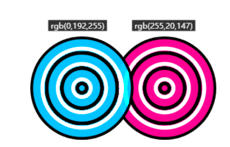

color-dodge颜色变淡混合模式可以用来保护底图的高光，适合处理高光下的人物照片，通过将照片和特定颜色混合，可以改变整个照片的色调（暖色调或是冷色调），而不会影响人物高光区域的细节。

color-burn的混合效果则是颜色加深：

\[
C = A - \frac{(255 - A)(255 - B)}{B}
\]

color-burn颜色加深混合模式可以用来保护底图的阴影，适合处理“幽深秘境”一类的照片，通过将照片和特定颜色混合，可以营造更加幽深的氛围。

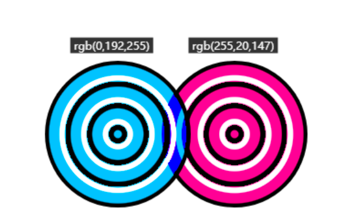

## 6 mix-blend-mode:hard-light/soft-light

hard-light混合效果是强光，就好像耀眼的聚光灯照射过来，表现为图像亮的地方更亮，暗的地方更暗:
\[
C =
\begin{cases}
\dfrac{AB}{128}, & B \leq 128 \\[10pt]
255 - \dfrac{(255 - A)(255 - B)}{128}, & B > 128
\end{cases}
\]

hard-light和overlay的区别在于，hard-light根据上层元素的色值判断是使用正片叠底还是滤色模式，overlay则根据下层元素的色值进行判断。具体表现为：当上层元素的色值大于128的时候，运行滤色算法，底色变亮，有助于增强图像的高光；当上层元素的色值小于或等于128时，运行正片叠底算法，底色变暗，可增强图像的暗部：
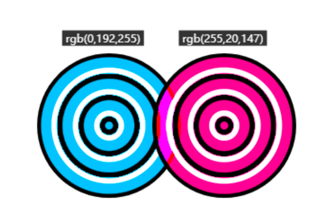

值soft-light的混合效果是柔光，就好像发散的光源四处弥漫，它的表现效果和hard-light有类似之处，只是表现没有hard-light那么强烈。例如纯黑或纯白的上层元素与底层元素混合后的效果仅仅是元素轻微变暗或变亮，而不是变成纯黑或纯白：

\[
C =
\begin{cases}
\dfrac{AB}{128} + \left(\dfrac{A}{255}\right)^2 (255 - 2B), & B \leq 128 \\[12pt]
255 - \dfrac{(255 - A)(255 - B)}{128}, & B > 128
\end{cases}
\]

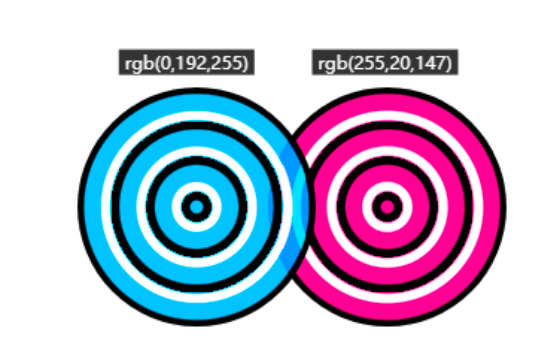

柔光强光的实际效果：
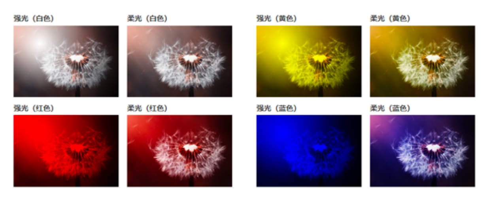

## 7 mix-blend-mode:difference/exclusion

值difference的混合效果是差值，最终颜色的色值是用较浅颜色的色值减去较深颜色的色值的结果：
\[
C = \lvert A - B \rvert
\]

如果上层元素的颜色是白色，则最终混合的颜色是底层元素颜色的反色。我们可以使用这一特性实现文字在不同图形区域显示不同颜色的效果：

```css
.difference {
  /*鸟图像设置为白色 */
  background-color: #fff;
  -webkit-mask: url(bird.png);
  /* 使用差值模式进行混合 */
  mix-blend-mode: difference;
}
```

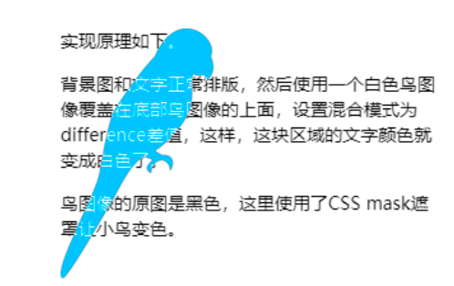

值exclusion的混合效果是排除，最终的混合效果和difference模式是类似的，区别在于exclusion的对比度要更低一些：

\[
C = A + B - \frac{AB}{128}
\]

差异体现：
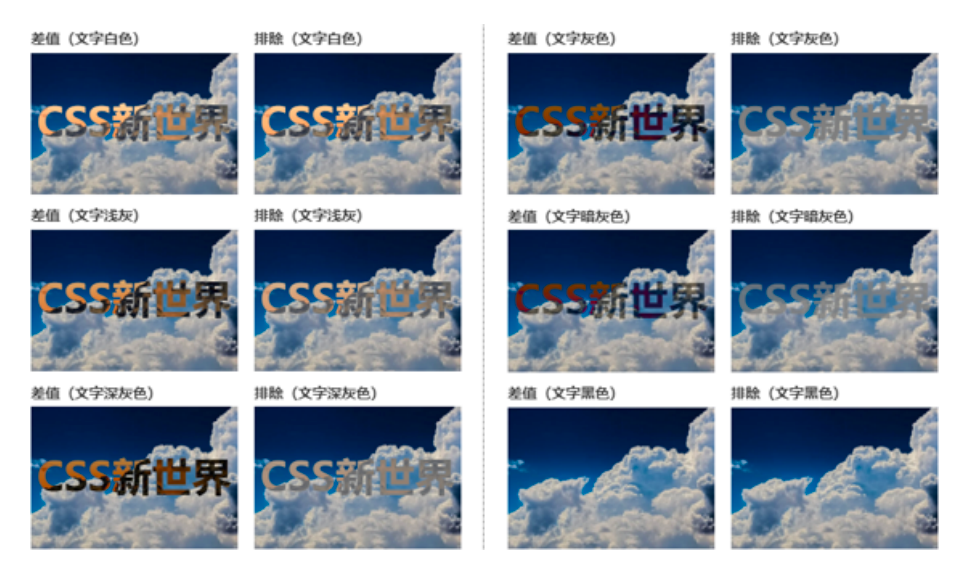

## 8 mix-blend-mode:hue

值hue表示色调混合，作用是将颜色混合，使用底层元素的亮度和饱和度，以及上层元素的色调。

贴士：所有颜色系混合模式（色调、饱和度、颜色和亮度）都不要使用黑色进行混合，因为这样会挖掉底层元素的颜色信息，导致最终混合后的颜色是灰色。

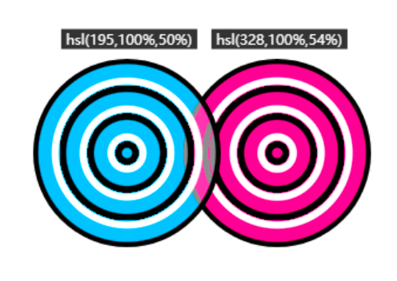

使用场景：将照片和渐变色进行色调混合，就可以让照片呈现出丰富多彩的色调效果。

## 9 mix-blend-mode:saturation

值saturation表示饱和度混合，混合后的颜色保留底图的亮度和色调，并使用顶图的饱和度

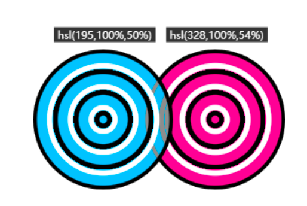

## 10 mix-blend-mode:color/luminosity

值color表示颜色混合，混合后的颜色保留底图的亮度，并使用顶图的色调和饱和度。

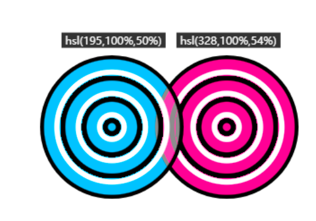

颜色混合模式也可以通过使用CSS渐变让照片的色调变得丰富起来：
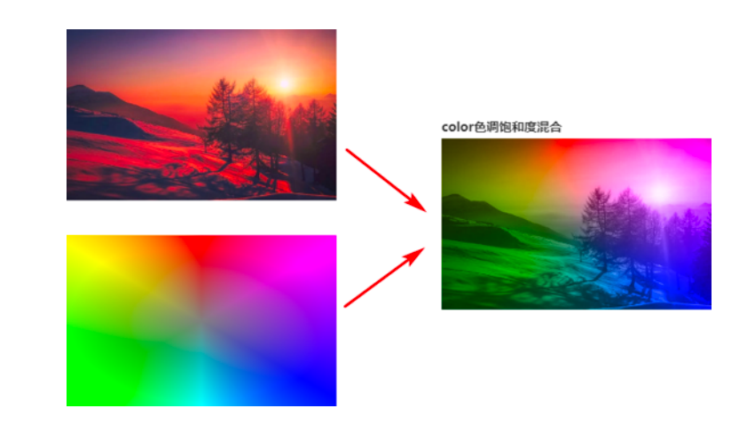

值luminosity表示亮度混合，混合后的颜色保留底图的色调和饱和度，并使用顶图的亮度，效果和color模式正好是相反的：

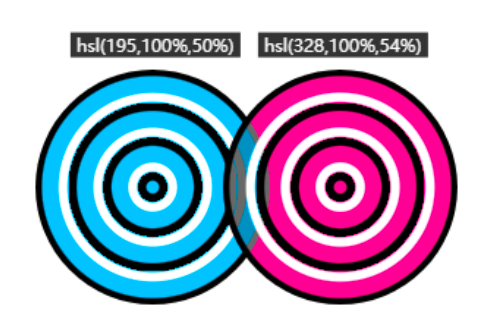

亮度混合模式并不适合将色彩丰富的图像作为底图，因为图像中的各种颜色的亮度是不一样的，如果替换成有规律的亮度值，效果会很奇怪：

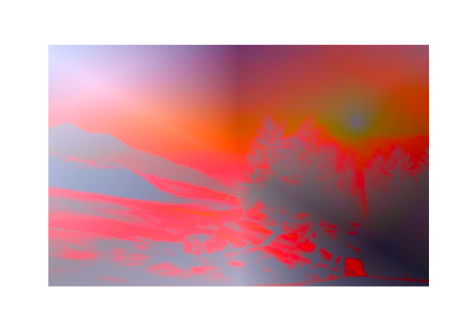

当底图是渐变图像或纯色图像，而上层元素是复杂图像的时候，适合使用亮度混合模式，这和color模式正好相反。

## 11 综合案例

### 11.1 夜晚模拟

利用滤镜和混合模式，使用白天的素材可以模拟夜晚效果，无需多张图片：

```css
.night {
  width: 256px;
  height: 256px;
  background: rgba(0, 40, 140, 0.6) url(./house-bed.jpg);
  background-size: 100%;
  background-blend-mode: darken;
  filter: brightness(80%) grayscale(20%) contrast(1.2);
}
```

### 11.2 纹理

使用CSS渐变和background多背景特性实现背景纹理效果，而了background-blend-mode 可以让纹理效果更丰富，比如以前纵横交错的两个纯色纹理最多只有两种颜色，但是一旦应用混合
模式，就会多出一种颜色：

```css
.pattern {
  width: 300px;
  height: 180px;
  --gradient: transparent 20px, lightcoral 0 40px, transparent 0 60px;
  background:
    repeating-linear-gradient(var(--gradient)),
    repeating-linear-gradient(90deg, var(--gradient)), floralwhite;
  /* 应用正片叠底混合模式 */
  background-blend-mode: multiply;
}
```

## 12 注意

###

background-blend-mode属性其实可以设置多个混合模式值，分别对应不同的背景图像，而mix-blend-mode属性只支持一个混合模式值，即：每张背景图像都有一个自己的混合模式值。

```css
.ball {
  background:
    linear-gradient(deeppink, deeppink),
    linear-gradient(deepskyblue, deepskyblue);
  background-blend-mode: overlay; // 等价于 background-blend-mode: overlay overlay;
}
```

上述两个渐变色层其实都使用了叠加混合模式，由于deeppink渐变层在最上层，因此deeppink渐变层实际上叠加的是deepskyblue渐变层和背景色（这段代码的背景色是透明的），而deepskyblue渐
变层叠加的只有背景色。

下面这段代码 .box 元素总共呈现出5种颜色：

```css
.box {
  width: 200px;
  height: 200px;
  background:
    linear-gradient(to right bottom, deeppink 50%, transparent 50%),
    linear-gradient(to top right, deeppink 50%, transparent 50%), darkblue;
  background-blend-mode: multiply, screen;
  position: relative;
}
/* 中间原始的deeppink色值 */
.box::before {
  content: '';
  position: absolute;
  width: 33%;
  height: 33%;
  inset: 0;
  margin: auto;
  background-color: deeppink;
}
```

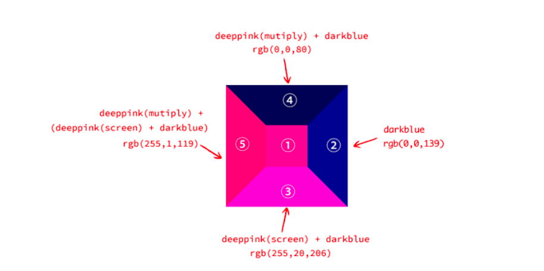

- 中间标注了序号①的正方形区域没有应用任何混合模式，颜色为deeppink，作用是方便和区域③、区域⑤处的颜色进行对比。
- 区域②就是背景色darkblue，因为两个斜向渐变均没有覆盖到这个区域，所以此处是设置的背景色。
- 区域③和区域⑤是下层渐变，也就是background属性值中位置靠后的渐变，对应的混合模式是background-blend-mode属性值靠后的那个，也就是screen（滤色模式），可以让颜色变亮。
- 区域④和区域⑤是上层渐变，也就是background属性值中位置靠前的渐变，对应的混合模式是background-blend-mode属性值靠前的那个，也就是multiply（正片叠底模式），可以让颜色变暗。
- 区域③的颜色表现为渐变色deeppink和背景色darkblue进行滤色混合的效果，可以看出最终呈现的颜色比deeppink更亮，最终混合后的色值是rgb(255,20,206)。
- 区域④的颜色表现为渐变色deeppink和背景色darkblue进行正片叠底混合的效果，可以看出最终呈现的颜色比darkblue更暗，最终混合后的色值是rgb(0,0,80)。
- 区域⑤总共有3层，分别是：上层的deeppink，混合模式是multiply；下层的deeppink，混合模式是screen；底层的背景色darkblue。最终的色值表现是上层的deeppink使用multiply混合
  下层的deeppink和背景色darkblue使用screen混合后的色值。由于下层的deeppink和背景色darkblue使用screen混合后的色值就是区域③的颜色。因此，区域⑤的颜色就是deeppink和区域③的色值rgb(255,20,206)进行正片叠底混合后的色值，结果是rgb(255,1,119)。

### 12.1 background-blend-mode属性与渐变图标的实现

现在有一个颜色很深的删除小图标，理论上，我们可以使用lighten混合模式实现渐变效果，因为lighten的效果是哪个颜色浅就使用哪个颜色。由于图标本身颜色很深，因此，一定会显示渐变
色，只要给图标加一个白色背景就可以：

```css
.icon-delete {
  background: linear-gradient(deepskyblue, deeppink), url(delete.png), white;
  background-blend-mode: lighten; /* 实际上的计算值: lighten lighten; */
}
```

但是最终的图标并不是渐变色，而是纯白色。是因为这里background-blend-mode:lighten中的lighten实际上是一个缩写（或者说简写），而真实的计算值应该是 `lighten lighten`。
即删除图标delete.png也应用了混合模式lighten，和白色背景色进行了混合，所以最后变成了纯白色。

解决办法是让delete.png和白色背景色混合后还保持原始图标的模样即可：

```css
.icon-delete {
  background: linear-gradient(deepskyblue, deeppink), url(delete.png), white;
  /* PNG图标的混合模式单独设置成darken */
  background-blend-mode: lighten, darken; //  lighten, normal; 也可
}
```

### 12.2 background-blend-mode属性的补全规则

当background-blend-mode的属性值的数量和background-image的属性值的数量不匹配的时候，应遵循下面的应用规则：

如果background-blend-mode的属性值的数量大于background-image的属性值的数量，则多出来的混合模式会被忽略：

```css
.example {
  background: linear-gradient(deepskyblue, deeppink), white;
  background-blend-mode: lighten, darken; // 等同于 lighten;
}
```

如果background-blend-mode的属性值的数量少于background-image属性值的数量，则会重复完整的background-blend-mode属性值进行补全：

```css
.example {
  background:
    linear-gradient(deepskyblue, deeppink),
    linear-gradient(deepskyblue, deeppink),
    linear-gradient(deepskyblue, deeppink), white;
  background-blend-mode: lighten, darken; // 等同于 lighten, darken, lighten;
}
```

## 13 isolation: isolate 混合模式隔离

isolation: isolate用来隔离混合模式，限制混合模式的作用范围：

- `isolation: auto;`是默认值，表示混合模式隔离与否根据具体情况而定
- `isolation: isolate;`表示对混合模式进行隔离。

当元素应用了混合模式的时候，在默认情况下，该元素会混合Z轴上所有层叠顺序比其低的层叠元素。但是，有时候我们希望混合模式效果只应用到某一个元素或某一组元素上，就需要进行隔离：

```html
<style>
  .box {
    background: linear-gradient(deepskyblue, deeppink);
  }
  .inner {
    background: url(demo1.jpg);
  }
  .mode {
    mix-blend-mode: overlay;
  }
</style>

<div class="box">
  <div class="inner">
    
  </div>
</div>
```

demo1 这个图片和demo2这张背景图片、渐变背景都发生了混合。如果希望实现的效果仅仅是两张图片发生混合，而不与渐变背景发生混合：

```css
.inner {
  isolation: isolate;
}
```

隔离混合模式的本质上是isolation: isolate创建了一个新的层叠上下文（stacking context）。只要元素可以创建层叠上下文，就可以隔离mix- blend-mode属性！
所以隔离的方案除了 isolate 还有：

- position:relative或position:absolute定位元素的zindex值不为auto。
- position:fixed固定定位元素。
- flex子项的z-index值不为auto。
- 元素的opacity属性值不是1。
- 元素的clip-path属性值不是none。
- 元素的transform属性值不是none。
- 元素的mix-blend-mode属性值不是normal。
- 元素的filter属性值不是none。
- 元素的contain属性值不是none。
- will-change指定的属性值为opacity、clip-path、
- transform、mix-blend-mode、filter和contain中的任意一个
- 元素的-webkit-overflow-scrolling设为touch
